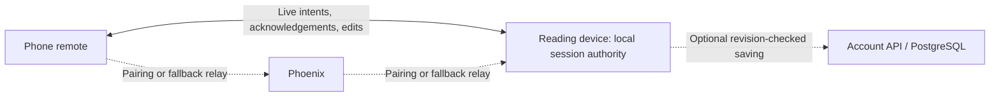

# IZZY — direct communication and offline operation

Date: 2026-10-12. Status: implementation started. The opt-in `/local` foundation and experimental manual peer adapter exist; hosted sessions retain Phoenix authority. See [Local preview](LOCAL_PREVIEW.md) for usage and verified boundaries. Paired offline acceptance remains open.

This is the active plan for this topic. It supersedes the deferral and proposed delivery order in [OFFLINE_FIELD_PLAN.md](OFFLINE_FIELD_PLAN.md), retaining that research and the optional [computer-hosted LAN package](OFFLINE_LAN.md).

## Recommendation

Keep Phoenix available, add direct browser-to-browser control using WebRTC DataChannels, and make the same local session usable without internet after preparation. Prioritize tablet + phone use without a computer.

Separate connection setup, live control, and durable cloud saving. Phoenix can introduce devices without carrying every jog command. Account saving can happen independently without delaying play, pause or scrolling.

The display already animates locally; we have not established an animation or server-capacity failure. Measure current command latency and capacity before claiming improvement. The intended gains are faster input response, less live-session server work, and continued control when internet disappears.

## Operating modes

| Mode | Live session authority | Communication | Internet requirement |
| --- | --- | --- | --- |
| Existing hosted session | Phoenix Session GenServer | Current Phoenix Channels | Required for remote control |
| Direct session, online setup | Reading device | WebRTC; Phoenix introduces devices | Setup and optional cloud saving; direct control survives cloud loss while the peer path remains reachable |
| Direct session, offline setup | Reading device | WebRTC; local offer/answer exchange | None after app preparation; devices still need a reachable local network |
| Standalone local session | Reading device | Local controller, no peer | None after app/script preparation |
| Existing computer-hosted LAN | Local Phoenix instance | LAN WebSockets | None after package preparation; computer required |

First direct release: one reading device and one remote. The editor runs on the reading device before the take. Independent third-device editing, meshes and automatic primary-display election stay outside this slice. Retain hosted mode for its existing multi-surface workflows.

Devices on different networks can continue using hosted mode. Direct mode may also connect across networks, but success is not universal and a non-relayed internet path is not necessarily local. Do not add TURN infrastructure initially: it relays traffic and introduces another operating cost. Phoenix supplies the first online fallback.

The solid path is direct communication. Offline setup replaces Phoenix introduction with a local exchange of connection details. WebRTC leaves signaling to the application; it does not supply offline discovery or pairing. [WebRTC peer connections](https://webrtc.org/getting-started/peer-connections).

## Current code and extension points

| Existing area | Current behavior | Planned extension |
| --- | --- | --- |
| `src/prompt/` | Local animation, measured layout, semantic anchors and recovery | Reuse rendering; adapt session/clock input to a local authority |
| `src/realtime/useSession.ts`, `protocol.ts` | Phoenix lifecycle, snapshots, revisions, roles and acknowledged commands | Keep the current adapter; add a small controller contract and separate direct protocol |
| `src/pages/DisplayPage.tsx` | Controls require a joined Phoenix session | Derive readiness from the active controller, including standalone mode |
| `src/pages/RemotePage.tsx`, `QuickEdit.tsx`, `components/JogControls.tsx` | Wheel, navigation, speed and revision-checked paragraph editing | Preserve controls/design; route intents through the controller contract |
| `api/lib/teleprompter/sessions/session.ex` | Hosted ordering, document revisions, edit ownership, replay and traffic guards | Preserve hosted authority; use its behavior as the local contract reference |
| `src/domain/storage.ts`, `src/account/pendingEdits.ts` | Workspace drafts/settings and account pending edits | Add a dedicated prepared-document collection and recoverable local-take state |
| `src/App.tsx`, `api/lib/teleprompter_web/router.ex`, `app_assets.ex` | Explicit app routes and bundled assets | Add local routes, manifest, worker scope and offline navigation |
| `api/lib/teleprompter_web/security_headers.ex` | Production denies camera access | If QR scanning is viable, permit camera on the pairing document only; retain microphone denial |

Implementation now includes a controller contract, standalone authority, prepared IndexedDB library, offline shell and manual WebRTC adapter. Account pending edits remain separate from prepared scripts. Online rendezvous, host-routed relay, QR scanning and account synchronization are pending. Existing LAN packaging is a different topology and does not prove computer-free offline pairing.

## Connection and pairing experience

### Online

1. Start a direct-capable take on the reading device. Generate a local session ID, fresh epoch and role capability; script upload is not necessary merely to pair.
2. Show the familiar remote QR. Phoenix supplies a short-lived, capability-protected rendezvous for offer/answer and candidate exchange. Start with opt-in mode selection behind a feature flag.
3. Try direct setup within a bounded window, provisionally five seconds. Authenticate the peer, transfer the initial snapshot and confirm it was applied before enabling controls.
4. If setup fails, offer/use the host-routed Phoenix relay below when both devices can reach it. Once tested, Auto can select a path before controls are enabled. Keep the current hosted start path selectable.
5. Show **Direct**, **Via server**, or **Remote disconnected**. Device saving and account saving have separate status.

Cloud loss must not disable a healthy direct peer or its editing. New pairing or an ICE restart may require local signaling if Phoenix is unavailable. Direct mode therefore needs both online and offline setup, not just an online connection left open.

### Prepare for offline use

Prepare the app on both intended devices and the selected script on the reading device. Validate app assets and document persistence separately before showing readiness. Provide an **Open offline check** and text export. A never-prepared phone cannot load the hosted app from an offline QR.

Use a versioned service-worker shell and IndexedDB documents. Offline entry bypasses login/account discovery and `/api/sessions`. Cache required bundled assets and supported local navigation only, not authentication, payment or arbitrary private API responses. Handle quota, unavailable storage and migrations without losing drafts. Keep active takes on a coherent build; defer update activation/reload until the take ends.

Service workers require a secure context. Test preparation against trusted HTTPS rather than private-IP HTTP phone preview. Storage may be evicted; request persistence where available, recheck readiness on opening and retain export. Ordinary tabs and Home Screen installations require separate preparation/verification. [Service Worker API](https://developer.mozilla.org/en-US/docs/Web/API/Service_Worker_API), [WebKit storage policy](https://webkit.org/blog/14403/updates-to-storage-policy/).

### Fresh pairing without internet

1. Cold-open the prepared app on both devices. Join a reachable no-uplink router or a physically verified hotspot topology.
2. The display starts a local take and creates an offer with `iceServers: []`. Gather local candidates before exporting the bounded offer. No external signaling, STUN, TURN, login or session-creation request may be required.
3. The remote imports the offer, gathers its answer/candidates and sends them back through a second scan/import. Prototype an in-app scanner plus bounded file/text import. Do not assume the system QR camera can hand a large payload to the cached app without navigation problems.
4. Bind negotiation messages and peer fingerprints to the fresh session/capability, confirm the remote on the display, then complete a version/role handshake and snapshot transfer over the data channel. Script text travels over the channel, never inside the QR.
5. Enable controls only after snapshot acceptance. Interrupted or expired negotiation starts again with fresh material.

QR size, candidate exposure, mDNS resolution and camera ergonomics are feasibility gates. Measure negotiation size; a single QR each way may be insufficient. Prototype bounded compression or multi-frame scanning only if needed and usable. Network changes require fresh signaling; connection details prepared at home are not reusable at another location. Host candidates describe possible local paths, not guaranteed reachability. [WebRTC connectivity](https://developer.mozilla.org/en-US/docs/Web/API/WebRTC_API/Connectivity), [WebRTC specification](https://w3c.github.io/webrtc-pc/).

Offline means no internet uplink, not no connection between devices. Client-isolated Wi-Fi may block peers. Hotspot host/client reachability and behavior without cellular service need physical tests per supported combination. Generic browser Bluetooth or Wi-Fi Direct discovery is outside this plan.

## One authority, independent connection paths

Introduce a narrow controller API: read/subscribe to snapshots, submit acknowledged intents, inspect readiness/path, reconnect and dispose. UI components consume this API; sockets and peer objects stay in adapters. Avoid a general networking framework.

Maintain two explicit session families:

- **Hosted:** Phoenix remains authoritative with protocol v2 behavior. A direct shortcut cannot bypass its ordering while claiming Phoenix still owns the take.
- **Direct/local:** the reading device orders every command and owns document, transport and edit revisions. Standalone, WebRTC and optional Phoenix relay are paths to this same controller. Relay is never a second state owner.

Direct fallback requires a new host-routed relay endpoint/channel: remote → Phoenix → reading-device controller → acknowledged result. Today's `transport:*` handlers mutate a different hosted session and cannot serve as that fallback. Relay joins are role/capability checked, bound to the take/host and refused when the host is absent. Keep v2 intact and explicitly negotiate the new protocol.

Direct commands carry protocol version, session epoch, connection generation, sender sequence, command ID and applicable base revisions. The host validates permissions, bounds, edit ownership and ordering; it returns the applied revision/result. Use bounded deduplication across both paths. Incompatible schemas disable controls with recovery guidance.

Path handoff is a handshake: disable input, stop/discard old queued gestures, reconcile uncertain commands with the host snapshot/deduplication results, activate a new generation, then re-enable. Never retry an uncertain jog as a new command through another path. Keep a stable path while healthy; do not switch on every latency fluctuation.

If the display sleeps or closes, the relay cannot substitute for it. Pause/recover the local take; do not elect the remote or revive an older server snapshot. A hosted replacement is an explicit new session from the preserved document/anchor. Switching an existing hosted take to local mode also requires explicit takeover into a new epoch. Returning internet never automatically merges live transport state.

## Responsiveness and complete local behavior

- Playback stays on the display's monotonic local clock with `requestAnimationFrame`. Apply direct commands without waiting for Phoenix/account writes. Translate hosted time anchors at the adapter boundary; do not treat `anchor_server_time` as the local clock.
- Start with reliable ordered controls and acknowledgements. Accumulate unsent jog deltas within the existing approximately 30 Hz budget, coalesce absolute speed values before sending and flush the final gesture value. Do not drop transmitted relative deltas or treat optimistic phone animation as confirmed display movement.
- Keep measured paragraph/character checkpoints at approximately 2 Hz while moving plus command/reflow updates. Preserve stable IDs, semantic PREV/NEXT and anchor remapping through typography/text changes.
- Chunk large snapshots with size bounds, transfer IDs and a revision barrier. Respect negotiated message limits; use `bufferedAmount` backpressure and yield to controls. Separate bulk/control channels help scheduling but do not alone remove transport blocking. [Data-channel buffering and size limits](https://developer.mozilla.org/en-US/docs/Web/API/WebRTC_API/Using_data_channels).
- Include Quick Edit in completeness: pause at the measured paragraph, one edit owner, expected revisions, text/anchor remapping, ownership release on disconnect, preserved unsent drafts and explicit resume. A play/pause demo is not a complete alternative.
- Derive readiness from the actual handshake/fresh snapshot. `navigator.onLine` and offline events are hints and must not close a healthy peer or disable standalone controls. Refactor current hard gates in `useSession.ts`/`lifecycle.ts` at the adapter boundary. [MDN onLine guidance](https://developer.mozilla.org/en-US/docs/Web/API/Navigator/onLine).

Proposed paired-loss policy: heartbeat each second; after three missed heartbeats disable remote input, invalidate that connection generation and pause at the measured anchor. Reject late buffered messages from that generation; resume requires a fresh handshake/snapshot. Bound control buffers and outstanding acknowledgements so reliable delivery cannot accumulate seconds of old gestures. Display controls remain available for explicit standalone continuation. Cloud-only loss has no playback effect. Validate these starting values physically. After display suspension/reload/cold start, restore paused without counting time asleep as progress. Phone foreground/resume always obtains fresh state first.

## Persistence and account synchronization

Persist prepared text, settings, stable block IDs and semantic anchors on the reading device. Separate content recovery from ephemeral peer identity; reload creates a fresh epoch and re-pairs as needed. Distinguish **applied to take**, **saved on device**, and **saved to account**. Storage failure preserves in-memory text and exposes retry/export.

Account copies retain account/script identity, base saved revision and pending mutations separately from the existing per-tab pending-edit journal. Downloaded copies remain readable offline; cached identity does not authorize upload.

Cloud writes are debounced content changes or explicit save/end-of-take flushes, never frame/jog updates. Reuse revision/mutation-ID rules and explicit conflict handling; reauthenticate and verify the same account before upload. Existing one-writable-saved-session coordination must recognize an online local take or treat its save as a conflicting draft. Offline copies remain drafts against their recorded base revision until synchronized.

Account updates must not automatically replace a running take. Preserve it before offering review/copy/conflict resolution. Handle account switch/logout and copy removal with ownership checks and export/recovery for unsent work. Existing free cloud-library limits remain enforced; guest offline operation requires no account.

## Server work and operating limits

Healthy direct takes send no transport intents, reading checkpoints or mirrored live snapshots through Phoenix. Optional account saving sends document changes only. A small bounded online signaling/recovery connection may remain, with backoff/jitter; cloud failure must neither create retry storms nor interfere with the peer. Offline mode performs no repeated cloud polling.

Rendezvous records need separate short TTL/capacity budgets and cleanup. Do not retain a full six-hour hosted Session GenServer merely to introduce peers. Bound negotiation sizes/attempts and relay connection/message/byte rates using existing guard principles. Relay buffering is bounded and never queues gestures for an absent host.

Measure connection memory, rendezvous counts, relay fraction, CPU, egress, account-write rates and saturation. Signaling sockets, cloud saving and fallback users still consume resources. Do not claim a percentage improvement without representative comparison.

Keep diagnostics aggregated with fixed labels, without scripts, keys, raw SDP/candidates or persistent device identities. DataChannels encrypt traffic, but authentication still needs trusted pairing material. QR/manual import bounds, role permissions and text/command limits apply locally too. [Data-channel security](https://developer.mozilla.org/en-US/docs/Web/API/WebRTC_API/Using_data_channels).

## Delivery sequence and exit gates

| Phase | Deliverable | Exit evidence |
| --- | --- | --- |
| 0 — Baseline and feasibility | Measure hosted/LAN behavior; isolated cached-page, direct-channel and offline offer/answer spike | Physical iPad/iPhone and Android fresh no-uplink pairing results, payload/scan size, permissions and go/no-go |
| 1 — Local foundation | Controller contract, Phoenix adapter, standalone controller, app shell/document preparation | Cold-open with all networking disabled; local editing/controls/recovery; storage/update failures handled |
| 2 — Complete direct remote | Online rendezvous, peer adapter, transfer, all controls and Quick Edit | Full remote behavior on local authority; cloud loss leaves peer intact; ordering/text recovery proven |
| 3 — Offline setup/recovery | Proven offer/answer UX, fresh local pairing, lifecycle and re-pairing | Close both apps, remove internet, cold-open/create a new pair; reload, lock and network-change recovery |
| 4 — Fallback and saving | Host-routed relay, path handoff, account conflicts, existing hosted option | Same-host fallback without duplicate commands; absent host refuses; cloud state cannot overwrite local take |
| 5 — Controlled rollout | Flagged preview, device guide, load/resource comparison | Physical matrix and responsiveness targets met; relevant client/server/browser/release regressions pass |

Phase 0 is an isolated feasibility spike, before a public offline-remote promise. Standalone work can proceed independently. Direct mode remains opt-in until fallback/account integration is ready; Auto preference follows Phase 4.

Implementation checkpoint (2026-10-12): Phase 1 has browser-engine cold-start/recovery coverage and bundled-release coverage. Phase 0 native peer testing stalled with the Mac's VPN candidate; physical topology/latency/scan and app-update acceptance remain open. Parts of Phases 2–3 are isolated behind manual preview pairing, with deterministic protocol tests; this does not close their native/physical exit gates. Phases 4–5 have not started. Keep the paired-offline promise open.

If offline WebRTC or practical QR exchange fails on a target browser, narrow support to proven combinations and preserve hosted mode. Standalone plus the LAN package are useful fallbacks but do not fulfill computer-free two-device operation. A native companion or different local-signaling method would need a separate architecture decision. Keep paired offline completion open.

### Required acceptance matrix

Record actual browser/OS versions, topology, preparation context and outcomes in [REMOTE_DEVICE_QA.md](REMOTE_DEVICE_QA.md). Automated WebKit and phone emulation cannot close physical Safari/iOS gates.

| Scenario | Required result |
| --- | --- |
| Online LAN direct; block Phoenix/internet uplink only | All controls and Quick Edit work; cloud saving becomes pending |
| Fresh offline pair after both apps close, no-uplink router | No external requests needed; script transfers; full remote works |
| Standalone cold-open with all radios disabled | Text/settings load; local controls/editing work; anchor restores paused |
| iPad/iPhone Safari; installed contexts separately | Full flow in each advertised context |
| Android/Android and iPad/Android remote | Full flow for each advertised combination |
| Hotspot in each supported host/client direction, cellular unavailable | Explicit pass/fail; no blanket claim from router testing |
| Isolation, VPN, denied permission, version mismatch | Bounded failure; online fallback or clear local recovery |
| Lock/background/BFCache, display suspension, reload | Safe recovery, fresh state, no stale gestures or sleep-time jumps |
| Direct → relay → direct, late/duplicate/out-of-order messages | Single authority, applied-once commands, old generations refused |
| Long text, continuous jog, Unicode/IME, reflow, Quick Edit | Responsive controls, exact relative movement, preserved reading word |
| Storage denied/full/cleared, app update, different install context | Honest readiness; in-memory text/export; no false save result |
| Account conflict/switch, existing hosted writable take | Explicit reconciliation; no overwrite or cross-account upload |
| Malformed/oversized negotiation/snapshot, command/edit floods | Bounded resources, safe refusal, healthy take survives |

### Initial performance targets

These are proposed test thresholds, not measured results or guarantees:

- Healthy supported LAN, discrete input to visible display response: p95 ≤ 100 ms, p99 ≤ 200 ms during a sustained take. Record acknowledgment latency separately.
- No material animation regression against the same device's standalone baseline. Compare frame-time percentiles/missed frames for at least 30 minutes including jog, edits and reflow.
- Try direct setup within five seconds before online relay fallback. Record offline negotiation/scan time separately and confirm practical usability.
- Compare p50/p95/p99 for hosted, LAN Phoenix, direct and host-routed relay with matched workloads. Visible cross-device response needs synchronized instrumentation or external video; RTT/2 alone is insufficient.
- Compare backend resources at declared concurrency and direct/relay mix, using realistic 30 Hz gestures and 2 Hz checkpoints. Derive capacity from observed latency/resource headroom, not rate-limit defaults.

Adjust targets explicitly after Phase 0 and preserve failures. Run meaningful controller/ordering/storage tests, existing remote/Quick Edit browser scenarios, relevant Phoenix/relay/account tests and bundled offline/release checks as implementation touches those boundaries. Physical disconnected tests remain mandatory.

No hosting, public deployment, new dependency, commit or push has been performed for this implementation slice. The local preview does not establish production capacity or physical mobile acceptance.
