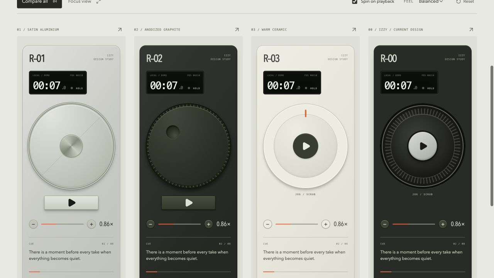
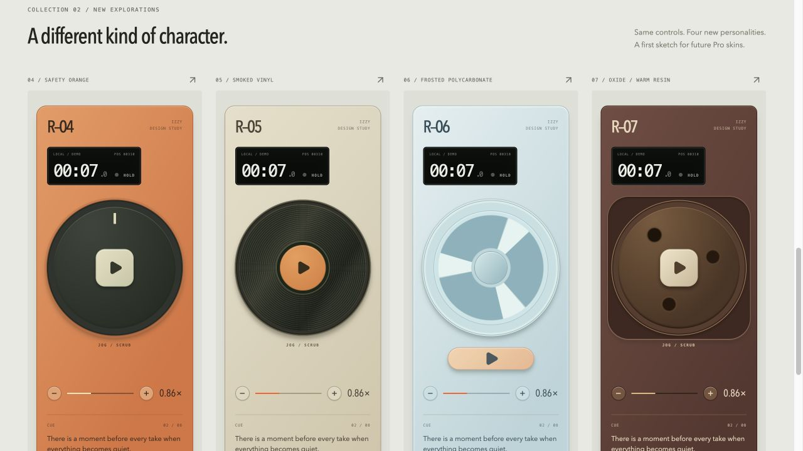
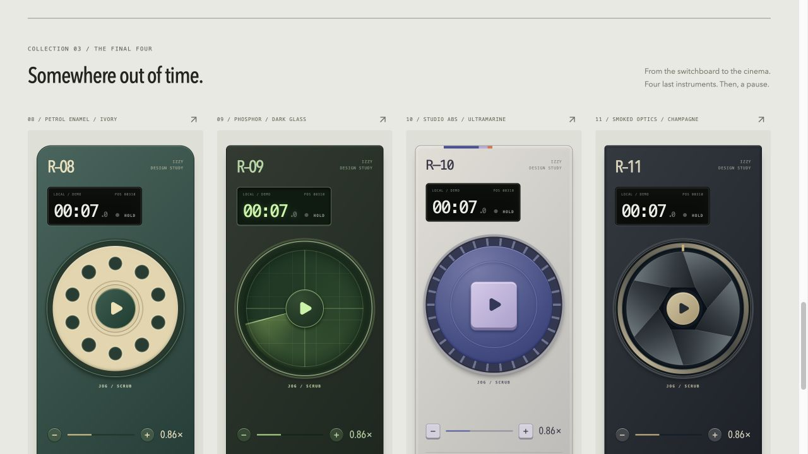
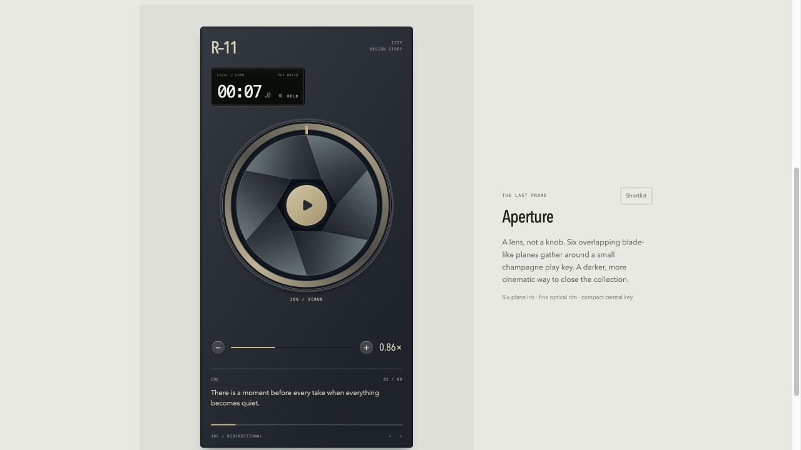
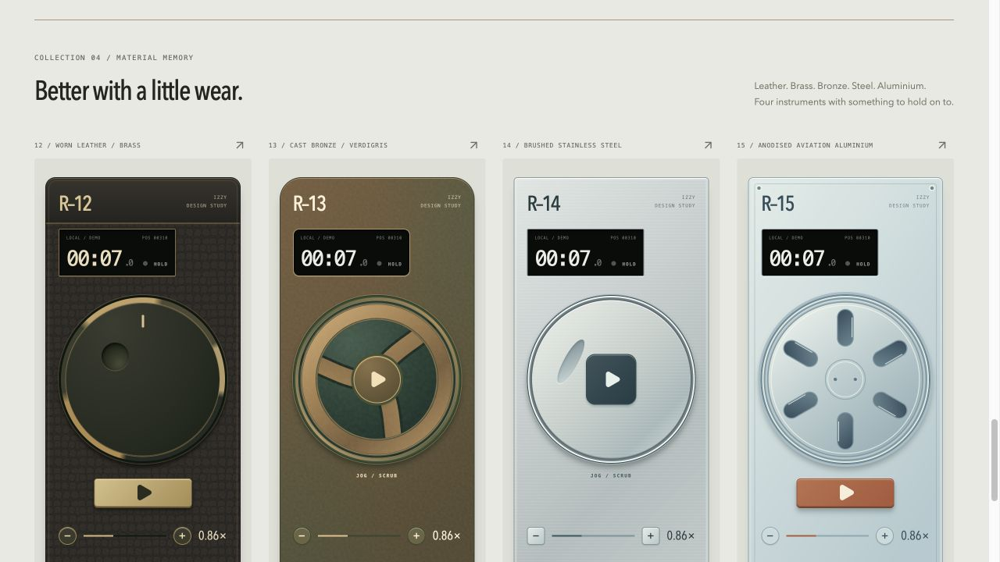

# IZZY — Remote instrument design playbook

Version 1.2 · 18 October 2026 · Owner: IZZY

**Make a different instrument. Keep the same understanding.**

This is the working standard for extending IZZY's remote-design collection: original studies, retro experiments and future brand collaborations. It records the decisions that made the first twelve studies work, the failure we corrected, and a repeatable route from brief to tested browser interface. It is not permission to launch skins, enable Pro, publish a collaboration or change the production remote.

## How to use this guide

For a new collection, read sections 1–8, complete the brief in section 9, and deliver the evidence in section 10. For a repair, inspect the affected design and use the relevant geometry/interaction checks; do not regenerate the collection. For a collaboration, also complete section 7. Section 11 explains preservation and repeatability.

The companion Codex skill is `izzy-remote-design`. The guide is canonical; the skill is a short entry point, not a second copy of these rules. Another designer or coding agent can use this document without the skill.

Contents: [Identity](#1-the-izzy-design-contract) · [Reference collection](#2-the-reference-collection) · [Creative method](#3-from-a-reference-to-an-instrument) · [Craft](#4-the-material-and-detail-system) · [Implementation](#5-the-code-and-interaction-contract) · [Quality](#6-quality-gates) · [Collaborations](#7-brand-collaborations) · [Workflow](#8-the-repeatable-round) · [Brief](#9-reusable-creative-brief) · [Handoff](#10-delivery-and-review) · [Preservation](#11-preservation-and-reproducibility)

## 1. The IZZY design contract

### Product first

The remote helps someone deliver a take while looking at the lens, not inspect a dashboard. Its essential tasks are to play/pause, scrub backwards or forwards, change speed and understand the actual transport/connection state. Appearance can create delight; it must not introduce a different operating model.

The original direction came from the owner's Teenage Engineering TP–7 and Ulanzi references. Extract broad control surfaces, restrained labels, useful miniature readouts and considered physical details. Do not reproduce another manufacturer's branding or assume that imitating a photograph creates a good browser control.

### What remains recognisably IZZY

- One visually dominant, centred jog surface. It feels intentional, not squeezed between settings.
- One unambiguous transport action: a central key or a separate key immediately below the wheel. Both arrangements belong to the system.
- Speed below the wheel, with breathing room and readable feedback.
- A compact, high-contrast transport readout. Treat it as an instrument, not a promotional badge.
- Quiet hierarchy: operation first, character second, tiny marks last.
- Honest state. A decorative sweep is not connection quality, a numeric index is not script progress unless it really encodes progress, and a demo is visibly a demo.
- Consistent accessibility, gesture direction, speed limits and playback correctness across every appearance.

### What can change

Wheel geometry and surface, casing radius, palette, material interpretation, grip language, decorative engraving, readout treatment, key shape, and the relationship between a stationary surround and rotating face. Change enough of these to establish a distinct idea; do not alter behaviour to make the idea work.

The existing tiny lab markings are presentation details, not approved production text sizes. Production needs its own legibility and physical-device acceptance. The lab's short excerpt is a scrub-feedback aid; it does not settle whether a full “Now reading” paragraph belongs on the real remote.

### Current owner decisions, not permanent laws

As of this version, R–03 **Orbit** is the preferred default candidate. The owner especially praised R–09 **Vector**, the radar-like direction. The founding twelve are preserved in their original archive. On 13 October the owner resumed exploration for Collection 04, adding four raw-material designs; all sixteen are retained. Generation stops after each requested round. These are recorded preferences, not automatic production approvals.

## 2. The reference collection

The running development gallery is `/lab/jog`. Its implementation, not a generated picture, is the functional reference. Source IDs below are stable; display numbers are not array indices.

| Study / source ID | Defining idea | Lesson worth retaining |
| --- | --- | --- |
| R–01 Field reel / `field` | Broad satin disc, engraved seam, separate transport | Restraint can be tactile; leave the disc room. |
| R–02 Thumbprint / `graphite` | Dark grip and an offset finger recess | One useful-looking detail can carry a whole design. |
| R–03 Orbit / `ivory` | Warm ceramic ring, one orange index, dark central key | A default can be calm, clear and distinctive. |
| R–00 Original / `original` | Existing knurled production geometry | Keep a familiar baseline for comparisons. |
| R–04 Signal / `signal` | Orange enamel, charcoal disc, cream square key | Strong colour works when control hierarchy stays quiet. |
| R–05 Groove / `groove` | Fine vinyl rings, warm studio casing | Material has a characteristic pattern, not just a colour. |
| R–06 Glacier / `glacier` | Frosted three-spoke reel, floating peach key | Explore translucency through restrained edges and layering. |
| R–07 Bakelite / `oxide` | Oxblood resin and a square recessed wheel bay | Stationary casing and rotating mechanisms have different jobs. |
| R–08 Switchboard / `switchboard` | Ten rotary-phone wells, petrol enamel, ivory | A recognisable cultural object can become a new control surface. |
| R–09 Vector / `vector` | Moving phosphor sweep beneath a fixed reticle | Motion and material can express one idea without extra functions. |
| R–10 Cartridge / `cartridge` | Studio ABS, ribbed blue shuttle, lavender key | Playfulness can come from manufacturing language, not decoration. |
| R–11 Aperture / `aperture` | Six optical planes, hexagonal opening, champagne key | Geometric closure is a quality requirement, not final polish. |
| R–12 Correspondent / `correspondent` | Leather wrap, worn brass edge, separate shutter-like key | Age should follow construction, not a distress overlay everywhere. |
| R–13 Foundry / `foundry` | Cast bronze, curved arms and recessed patina | Material contrast can distinguish a casting from a lightweight reel. |
| R–14 Inox / `inox` | Brushed steel and a shallow thumb channel | Precision depends on seams and proportion, not extreme chrome. |
| R–15 Airframe / `airframe` | Six lightening slots and pale machined aluminium | Subtractive geometry can express lightness without translucency. |

Visual references are saved with this guide, outside the ignored working-artifact folder:









These screenshots document the Mac/browser rendering at capture time. They are visual anchors, not evidence that all accessibility or physical-device checks passed. See [lab verification](JOG_WHEEL_LAB.md) for the actual scope of earlier testing.

The founding [baseline record](design/remote-skins/2026-10-12/BASELINE.md) includes a hash manifest and frozen copies of the relevant UI sources and dependency lockfile. These are an audit/reference capsule, not a standalone executable application. The live source paths below remain the implementation to edit.

Collection 04, **Material memory**, has its own [dated record and preservation capsule](design/remote-skins/2026-10-13-material-memory/COLLECTION.md), without altering the founding archive.

Latest Correspondent target: [single-cue refinement](design/remote-skins/2026-10-13-correspondent-refinement/REFINEMENT.md), retaining the finger well and removing the extra index line. The original collection comparison below is historical.



## 3. From a reference to an instrument

### Extract a principle, not a costume

Write a short translation before coding:

1. **Source world:** an object, era, material or cultural setting.
2. **Physical principle:** what makes its design memorable—recess, reel, seam, optical overlap, moulded grip, illuminated glass.
3. **Digital interpretation:** which existing IZZY parts express that principle.
4. **Restraint:** the tempting feature or decoration deliberately omitted.
5. **Signature:** the one detail someone should remember tomorrow.

Example: “A late-night laboratory screen → light sweeping below fixed glass → rotating wheel artwork under a stationary reticle → no fake signal measurements → one phosphor-green sweep.” This is why Vector reads as an instrument rather than a green theme.

Counterexample: “Make the current wheel green, add scan lines everywhere, label a random number SIGNAL.” That changes the costume while inventing meaning.

### Compose a collection, not four cousins

Four studies per round is the successful convention from the founding collection, not a requirement overriding a future brief. For a four-piece round, aim for a spread: one quiet/credible direction, one strongly tactile direction, one cultural or era-based reference, and one unexpected closing piece. These roles can overlap; they should not force a weak concept into production.

Compare candidates across source world, silhouette, light/dark balance, material, transport placement, and motion. If two candidates differ only in palette, combine or replace one before implementation. As a useful house heuristic, each should differ meaningfully from its neighbours on at least three axes. A brand brief may intentionally call for narrower variation; record that exception.

Think beyond adjacent audio hardware: optical instruments, telephone systems, field tools, video transport, laboratory glass, clocks or fabrication methods. Research only where it resolves a real question. A few strong, attributed references are more useful than an uncurated moodboard.

### Test the concept without its name

At thumbnail size, can a person distinguish it from the other studies? With the branding hidden, does the concept still exist? At phone size, can they find Play immediately? In a still frame, does it still work? If the answer needs a paragraph of explanation, simplify the design.

## 4. The material and detail system

### Build a believable stack

Think in layers: casing → recess or bearing → grip/rim → disc or mechanism → transport key. Define the role of each visible border and shadow. A dark line should mean a seam, separation or edge; avoid several unexplained outlines describing the same boundary.

Use a coherent, mostly upper-left light direction. Highlights should agree across shell, wheel and keys; local glints can vary with orientation, but avoid unrelated light sources. Keep shadows shallow enough that the control remains legible on a dim phone.

### Choose material-specific cues

- **Metal:** restrained tonal shifts, precise seams and fine highlights. No default chrome bevel on every surface.
- **Ceramic:** broad quiet colour, soft edge and very limited specular detail.
- **ABS/enamel:** moulded geometry, coherent casing radius, a few purposeful grip or seam details.
- **Resin:** warm depth and concentrated edge highlights, not a full-screen brown texture.
- **Vinyl:** concentric structure with enough spacing to avoid distracting moiré at different sizes and pixel densities.
- **Frosted polymer:** translucent-looking overlap and pale rims, while text and controls remain opaque and clear.
- **Optical mechanisms:** mechanically coherent boundaries; all repeated parts must close correctly.
- **Phosphor/glass:** controlled luminance and depth. Glow supports an actual element; it is not the entire interface.

These are interpretations, not physical simulations. Prefer the least rendering complexity that preserves the character.

### Keep graphic details subordinate

One dominant material, one supporting material and one deliberate accent is a useful starting point, not a maximum palette. Reserve the accent for a meaningful key, index or selected state. Do not rely on colour alone for operational state.

Keep the established typographic roles: a readable condensed instrument heading, monospaced technical annotation, and clear supporting text. Reuse the existing font system unless a specific concept justifies a change. The current platform fonts vary across operating systems; new fonts need appropriate licensing, local delivery and fallback testing.

Micro-labels may reward close inspection but must not carry essential instructions. Decorative numbers, screws, vents and scales need a convincing role or they go. A scale with no defined value is visual noise. A rotary-phone well or record groove can be expressive without pretending to be a calibrated scale.

### Separate stationary and moving parts

The casing, readout, labels, speed controls and transport key stay still. The wheel face and its directional signature may rotate. A reticle belongs to the fixed layer; a sweep belongs to the rotating layer. A rotating index indicates wheel orientation unless explicitly bound to another value—it is not a percentage gauge by default.

Keep decorative motion optional and respect reduced motion. Do not simulate resistance, inertia or haptics through sluggish commands. All skins must respond to the same input in the same way. Avoid continuous animation on idle faces and flashing decoration.

## 5. The code and interaction contract

### Authoritative implementation map

| File | Responsibility |
| --- | --- |
| `src/pages/JogLabPage.tsx` | Study metadata, local disposable playback, collection layout and focus/compare modes |
| `src/pages/jog-lab.css` | Lab-scoped materials and geometry |
| `src/components/JogControls.tsx` | Shared jog, keyboard, transport and speed semantics; also `TransportReadout` |
| `src/realtime/keyboard.ts` | Existing keyboard deltas and speed bounds |
| `src/prompt/motion.ts` | Shared movement baseline; not an appearance setting |
| `src/assets/lab-aperture.svg` | Corrected, scalable optical artwork |
| `src/App.tsx` | Development-only lab route and lazy import |

The online product now also has a sixteen-finish implementation candidate. Its
operating surface is separate from the lab's disposable demo state:

| File | Production-candidate responsibility |
| --- | --- |
| `src/product/catalog.ts` | Allowlisted IDs, model numbers, names and browser preference |
| `src/product/skins.css` | Shared material artwork plus explicitly scoped live sizing, legibility and focus rules |
| `src/prompt/timecode.ts` | One position-derived nominal time calculation for seconds and tenths |
| `src/pages/RemotePage.tsx` | Real connection/readout, shared controls, phrase navigation and Quick Edit |
| `src/product/useRemoteAppearance.ts` | Verified grant, preference and effective-skin fallback |
| `src/product/RemoteSkinLibrary.tsx` | In-session selection and keyboard focus return |
| `src/components/RemoteInstrument.tsx` | Inert showroom/library miniature; never proof of live operation |
| `test/e2e/remote-skin-readiness.spec.ts` | Catalog-driven paired-display and responsive gates for every finish |

When transferring a study, carry over its orientation cue and material-specific
speed ink as well as its disc/background. Lab microtype and small demo buttons
must not become production touch targets. Verify the live remote, not just a
miniature or lab card. Read [the current acceptance record](REMOTE_SKIN_QA.md)
and [product decisions](REMOTE_SKINS.md) before treating a candidate as released.

Preserve the existing shared controls. New geometry belongs in `.lab-device--<stable-id>` styles or inert, local artwork. Do not copy the interaction component per skin or add skin-specific protocol behaviour. A genuine shared-control bug can be repaired separately, with verification on the production remote and earlier studies.

Use CSS and SVG for rings, holes, blades, seams and geometric grip. A bitmap may be justified for a specific material or authorised brand asset; it must not turn the functional control into a screenshot. Decorative layers must not intercept pointer events, obscure focus or become extra accessibility stops.

New asset files must be self-contained. Do not embed scripts, external resources, event handlers or unreviewed markup in SVG. Sanitize supplied brand assets before use; do not render arbitrary account-provided HTML/CSS/URLs as a skin.

### Preserve operation

- Clockwise/counterclockwise seek direction and pointer capture remain the same.
- Play is a real button, separate from the slider semantics, even when visually centred inside it.
- The keyboard slider retains its accessible name, value, bounds and help; Home/End and arrow/Page keys still work.
- Focus and pressed/disabled states stay visible in every material.
- The speed range and increments come from the shared implementation. Do not recalibrate them for a skin.
- Enlarged invisible touch areas must not steal the neighbouring scrub or speed action. Verify their edges, not just their visual centres.
- A skin must not change saved scripts, Quick Edit, session capability links, connection gating, or pairing.

The lab is not a live remote: demo state is disposable, shortlisting is temporary, and focus/compare can remount devices. Do not describe these behaviours as account persistence or ship the lab's always-enabled controls as the production remote. Real connection state must still govern production controls.

### Geometry lesson: Aperture

The first artwork painted overlapping leaves in sequence. The closing leaf did not match the first, producing a notch beside the key. Scaling the artwork to 110% also obscured the outer construction. It was visually wrong even though drag and Play worked.

The correction uses a single sixth of an annulus, repeated in 60° rotations. Adjacent boundaries share endpoints, enclosing a hexagonal opening. The artwork fits its own viewBox at 100%; the stationary key sits above it. This removes painter-order asymmetry rather than disguising it with a larger button.

For any repeated mechanism, check closure at the first/last seam, not only two adjacent pieces. Inspect the complete circle at rest, after an arbitrary partial turn and while running, at both thumbnail and focus sizes. Avoid masks, shadow stacks or oversized centre keys that hide unresolved geometry.

### Performance and release isolation

Reuse the existing local animation path; avoid an independent timer or animation loop for every decorative layer. Transform/opacity effects are preferable to repeatedly laying out the interface. Large blurs, layered gradients and dense repeating patterns need real-device performance review. Do not claim a frame-rate budget without measurement.

New studies stay behind the development-only `/lab/jog` route unless shipping is separately requested. Verify that a production build does not include lab modules, styles or art. Identical production asset hashes were useful evidence for these lab-only additions, not a permanent requirement when unrelated production code changes.

## 6. Quality gates

### Visual gate

Review both the full collection and a focused device. Check balance, casing radius, wheel centring, readout clarity, wheel-to-speed spacing, illumination, consistent seams, material hierarchy and the closing seam of repeated geometry. Inspect in greyscale or otherwise assess luminance hierarchy separately from hue. Make sure new CSS has not restyled an earlier study.

Good craft survives at 320 CSS px as well as a large desktop. Review 320 and 390 px phones, a tablet in portrait/landscape, the normal desktop comparison, and text zoom. Do not shrink the whole interface to fit while leaving essential controls or text too small. If actual target dimensions differ, record them.

### Accessibility gate

Use these as acceptance targets, not a claim that the founding lab is already certified:

- Essential normal-sized text: at least 4.5:1 contrast; qualifying large text: at least 3:1. Measure against the rendered background, including material gradients. See [W3C text contrast guidance](https://www.w3.org/WAI/WCAG22/Understanding/contrast-minimum.html).
- Meaningful control boundaries, icons and state indicators: assess the applicable 3:1 requirement against adjacent colours. See [W3C non-text contrast guidance](https://www.w3.org/WAI/WCAG22/Understanding/non-text-contrast.html).
- IZZY's house target for primary touch actions is at least 44 × 44 CSS px, preferably larger where space permits. This borrows the enhanced target-size criterion; it is not a statement that 44 px is the universal AA minimum. Check actual, non-overlapping hit areas. See [W3C enhanced target-size guidance](https://www.w3.org/WAI/WCAG22/Understanding/target-size-enhanced.html).
- Decorative rotation can be disabled with reduced motion while operation remains available. See [W3C's reduced-motion technique](https://www.w3.org/WAI/WCAG22/Techniques/css/C39.html).

Test keyboard-only navigation, focus visibility, accessible values, button names and reduced-motion behaviour. Before a skin ships, also test actual screen-reader operation and physical iPhone/iPad Safari. A screenshot or emulated viewport does not establish these results.

### Functional gate

For every new or repaired skin, record actual outcomes:

| Check | Evidence required |
| --- | --- |
| Forward/backward drag | Position changes in both directions; grip and decorative overlays do not block the gesture |
| Gesture release/cancel | No stuck dragging state; key remains usable afterwards |
| Play/pause | State changes and demo position advances/stops; decorative motion is not the only evidence |
| Keyboard | Arrows/Page keys work; Home/End reach the known bounds |
| Speed | Plus/minus and range change the value within shared limits |
| View modes | Compare/focus, reset and shortlist remain usable; no missing studies |
| Narrow layout | No unintended horizontal overflow; key, wheel and speed remain usable |
| Static/reduced motion | Character survives with decorative rotation off; controls still work |
| Isolation | No account/session writes and no unexpected production-bundle inclusion |

Run the current client unit suite, production build and diff checks for code changes. Use wider integration suites in proportion to actual shared-code changes. Read current package scripts instead of freezing a test count into the process. Never infer browser correctness from a passing build.

For a live finish, run the catalog-driven readiness suite against a real paired
local display. Record per-finish browser results and the still-open physical and
screen-reader gates in [REMOTE_SKIN_QA.md](REMOTE_SKIN_QA.md). Disconnect during
an active captured drag: disabling controls must release the pointer so that
reconnection cannot resume an old gesture. A centered and a below-wheel Play key
need equally visible, separate keyboard focus. Essential ink must remain readable
when changing finishes; do not animate it through low-contrast intermediate colors.

### Judgment gate

Ask five questions: Is it recognisably its own idea? Is the material coherent? Is Play immediately clear? Does it feel as carefully made as the best existing study? Does it remain beautiful without motion or branding?

A broken control, illegible essential state, misleading indicator or visibly unfinished mechanism blocks acceptance regardless of novelty. If the craft is sound but the concept is weak, keep it as an explicitly labelled exploration or remove the new candidate from the round; do not silently replace an existing owner's favourite. Approval remains a human design decision, not a numeric claim of guaranteed taste.

## 7. Brand collaborations

### Translate identity, not advertising

A collaboration should feel like an instrument that IZZY and the partner could have designed together. The partner can influence material, shape, accent, graphic rhythm, typography or a signature detail. IZZY retains control semantics, reading hierarchy and honest state.

Start with three brand attributes and their physical consequences. Example for an invented outdoor partner: “precise, repairable, weathered” → a calibrated-looking rim with no fake values, a clear seam, and restrained mineral colours. No actual brand permission is implied by this example.

The logo-off test is essential: if removing the logo leaves an ordinary recolour, the design has not translated the identity. Conversely, literal product replicas, huge lockups, promotional copy and partner decoration around every control are not collaboration craft.

### Separate exploration from approval

Record the partner, asset provenance, allowed logo/font treatments, intended audience and approval status. With missing rights or an unconfirmed partnership, explore privately using a neutral name and generic design principles; mark the work “unapproved concept.” Do not invent endorsement, publish partner assets or describe the design as an official collaboration.

Before public release, the owner confirms permission for the assets, naming and intended use, plus relevant commercial terms. This guide is not legal clearance. Brand constraints do not excuse unreadable controls; propose a permitted high-contrast treatment or stop for a decision.

### Collaboration acceptance

Require the same usability and performance gates as an original skin, plus a partner review of asset treatment and an IZZY review of control clarity. Keep dated approval evidence separate from the creative rationale. Publishing, entitlement changes and deployment each require their own authorised implementation scope.

## 8. The repeatable round

1. **Orient.** Read this guide, current owner decisions and the live lab source. Inspect the baseline on screen. Check the worktree before edits; preserve unrelated changes.
2. **Frame.** Capture the brief and its scope. Decide whether this is exploration, repair, or explicitly authorised production work. Confirm only choices whose absence would materially change the result.
3. **Diverge.** Generate more candidate ideas than the requested deliverable count in short concept cards. No need to render every idea. Use source worlds and manufacturing principles, not adjective permutations.
4. **Curate.** Select a coherent but varied set. Note why it differs from the existing twelve and what was intentionally omitted. Share a concise direction update, not a long approval detour when implementation is already authorised.
5. **Build.** Append stable IDs, collection metadata and scoped styles. Keep the same sample, starting state and control logic for fair comparisons. Create real controls, not only pictures.
6. **Inspect.** Review the comparison, focus view, stationary and moving states. Fix mechanism geometry before adding ornament. Review the whole new set again after any shared-style edit.
7. **Verify.** Execute and record the applicable gates. Label unrun tests and physical-device gaps honestly. Keep the user's current session/data out of testing.
8. **Preserve and hand off.** Save new preview evidence without overwriting previous rounds, update the inventory and rationale, report the exact scope and remaining gaps, and stop at the requested count.

An owner-authorised new round resumes exploration; it does not erase the existing “pause after twelve” history. A request to fix one study does not authorise another four-piece collection. If a concept cannot be made usable without changing the control model, revise or replace the new concept rather than changing the product silently.

## 9. Reusable creative brief

Copy this into a future request or a dated collection note. Defaults below describe the founding method; override them deliberately when the brief calls for it.

```text
IZZY remote design round
Mode: exploration / repair / authorised production implementation
Deliverable count: four new studies unless explicitly changed
Collection title and source worlds:
Desired emotional range:
References supplied / research needed:
What must feel new relative to the existing collection:
Brand partner, asset permission and approval status, if applicable:
Non-negotiables: shared controls, honest state, accessibility, existing studies preserved
Default preference: retain the current owner decision; do not infer a production change
Target surfaces: phone first; tablet and desktop review
Implementation boundary: dev lab only unless explicitly authorised otherwise
Output: working variants, short concept rationale, saved comparisons, actual QA results
Stop condition: requested studies reviewed and verified; no automatic extra round
```

For each selected direction, record:

```text
Stable ID / display number / name:
Source world and physical principle:
One-sentence digital translation:
Signature detail:
Silhouette / material / palette / transport placement:
Stationary parts / rotating parts:
Deliberately omitted detail:
Difference from the closest existing study:
Asset provenance and permissions, if applicable:
Known risk and how it will be checked:
```

Example future request:

> Use the IZZY remote design playbook to create four new lab studies inspired by maritime instruments and early portable electronics. Preserve the twelve existing studies, keep the shared controls and current default preference, and make the new set differ in geometry and material—not only colour. Build and verify the interactive variants, save comparison evidence, then stop. Do not change the production remote or activate Pro.

For a repair, replace the creative round with a narrow brief such as: “Inspect Aperture's first/last blade seam at rest and while rotating; repair the mechanism without changing the other eleven studies.”

## 10. Delivery and review

Keep the user-facing handoff short, backed by a durable collection note containing:

- Collection date/version, source IDs and names; current default preference and any actual changes to it.
- Brief, reference provenance, selected concepts and one-line rationale per study.
- Local source/asset paths and a working preview URL, without private session capability links.
- Saved full-collection comparison and focused detail for fragile or repaired geometry; optional mobile evidence when it demonstrates a meaningful constraint.
- Test commands/results, actual viewports/browser, states checked, and unverified physical-device or accessibility items.
- Brand permission/approval status where relevant, and any distinction between a concept, implemented lab study and release-approved skin.

Use the same demo text and starting settings for comparison captures. The founding lab uses position 310, maximum 2400, speed 0.86×, paused; reset before a still comparison. A moving-state capture can use different values, but label it. Do not remove focus rings or change viewport sizing solely to make a screenshot look prettier. Restore temporary viewport overrides after testing.

Say what was preserved, what changed, and what was checked. Do not turn “79 tests passed” from this evening into a timeless acceptance claim. Future reports must use their own results.

## 11. Preservation and reproducibility

### What “repeatable” means

The process, inputs, implementation constraints, review criteria and evidence can be repeatable. The exact same source and asset files can be preserved and compared by hash. A new creative run cannot honestly guarantee the same idea quality, identical model output or pixel-identical rendering across browsers and fonts.

For an exact visual replay, retain source revision, lockfile, artwork, fonts and their licences, runtime/browser versions, viewport, zoom, device pixel ratio, motion preference and demo state. Record a model/tool version when available, but do not invent an image seed or promise that a prompt reproduces an image. New-generation repeatability and old-artifact reproducibility are different goals.

### Archive policy

- Append new stable IDs; do not recycle an ID for a different concept. R–00 remains the baseline; the next new display number after Collection 04 is R–16, unless the owner requests a different numbering scheme.
- New collections are additive. Preserve earlier definitions and their visual evidence. Narrow repairs keep the stable ID, add a dated correction note and a new preview, and identify the latest canonical version.
- Save reviewed evidence under `docs/design/remote-skins/<date-or-collection>/`, not only ignored `artifacts/`. Do not store credentials, account data or live capability links with screenshots.
- Save a small manifest with source and preview hashes when freezing a baseline. Hashes detect changes; they do not replace source history or a backup.
- Commit or push only when authorised. A locally saved guide and archive are not a GitHub backup. An uncommitted manifest records the current files, not an immutable repository release.
- Update this guide for meaningful new lessons, not every stylistic experiment. Record product decisions in [REMOTE_SKINS.md](REMOTE_SKINS.md), collection facts in [JOG_WHEEL_LAB.md](JOG_WHEEL_LAB.md), and avoid conflicting copies of the same instructions.

### Promotion to a real skin is a separate project

The lab is development-only and its sixteen designs are not shipped entitlements. Before promotion, select an approved skin, define appearance ownership/persistence, retain connection safeguards, choose allowlisted identifiers/tokens, and verify real-device operation, accessibility and performance. Pro checks remain server-authoritative; appearance revocation must not delete user data. See [product constraints](REMOTE_SKINS.md).

The free experience should remain excellent. Future collaborations and Pro skins add character—not a usability advantage withheld from the default remote.

---

The standard is not “make it look like expensive hardware.” It is: **give one clear idea a convincing physical expression, make every detail agree, and let the person get on with the take.**
