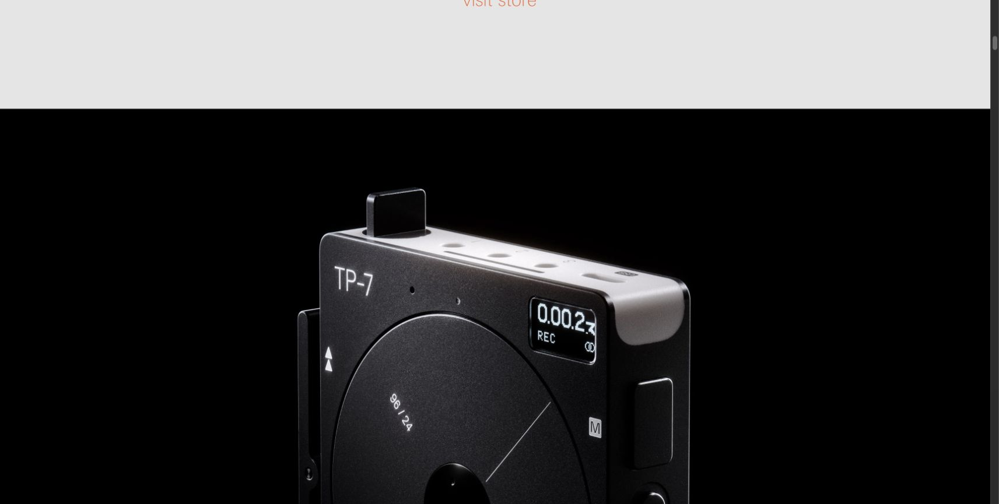
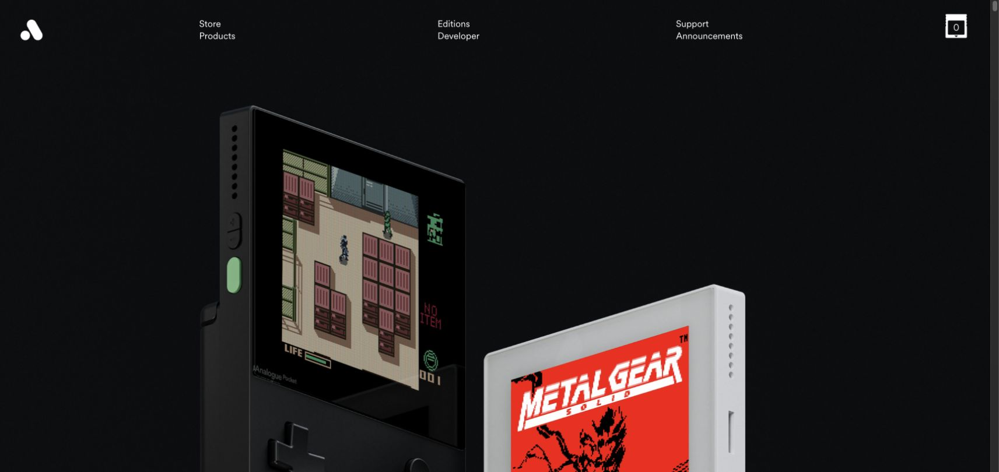
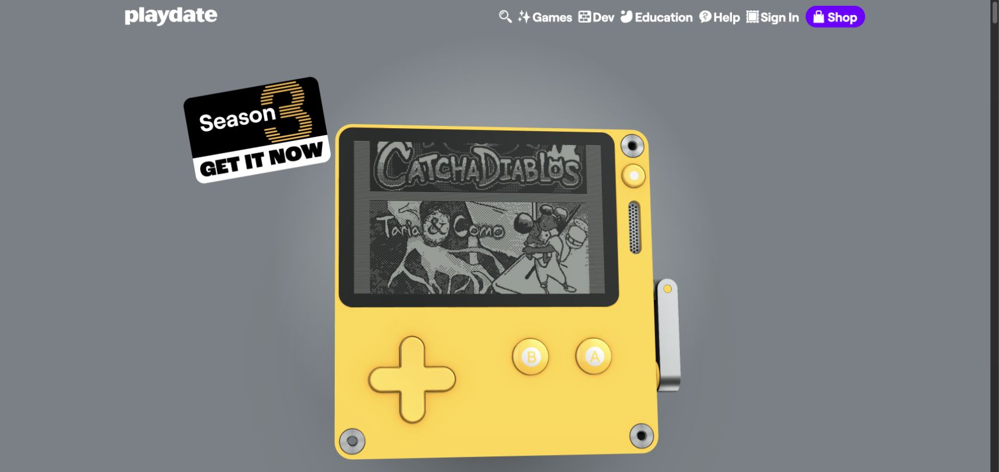
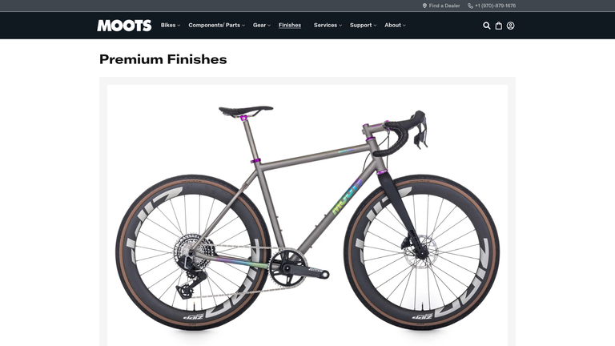
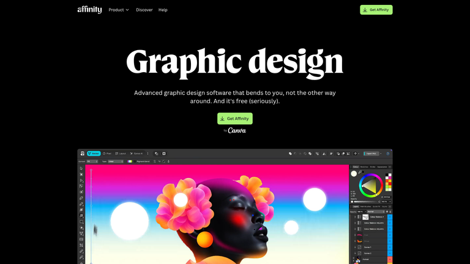

# IZZY — main page and PRO design research

14 October 2026 · Art direction research · Five selected references

## Recommendation

Present IZZY as a finely made instrument. Give the actual wheel, remote and script relationship visual authority. The main page should combine immediate use with a memorable product demonstration; PRO should build desire through materials, scale and a carefully paced collection. These are design interpretations of the references, not measured conversion claims.

The next deliverable is D0 in the execution plan: two coherent main/PRO page directions at desktop and mobile sizes, then one refined direction and a small motion proof. Reference research does not substitute for that design work.

## Evidence and limits

The selection combines three live browser captures with two Lazyweb screenshots, all from web/desktop references. Their mobile adaptation has not been inspected in this research turn. The existing IZZY skin playbook and studies remain the product's own source of identity. Current IZZY screenshots and synthetic baseline checks belong to P0; this report is not a live-product audit.

Five Lazyweb searches covered hardware landing pages, audio products, Apple product pages, creative software and premium finishes. Broad hardware matches were weak in relevance; the Apple library result was a product listing rather than a launch page. Sonos was excluded from the final selection because its archived full-page capture contained incomplete media and an obstructing signup panel. A high search-similarity score alone did not qualify a reference.

The legacy browse executable was unavailable. Live captures were taken with the connected Chrome browser instead. No extra inspiration library was configured.

## 1. Give the mechanism space



**[Web, live] [Teenage Engineering TP–7](https://teenage.engineering/products/tp-7).** The captured section gives a large, cropped view of the recorder against black. Its page separately explains the reel's operational role. For IZZY, use actual casing/rotor/index detail and link wheel feedback to script movement. Preserve control-state clarity. Do not copy its campaign photography or hide immediate use behind an image-only opening.

Suggested IZZY composition:

```text
ONE SCRIPT. TWO SCREENS.
┌─────────────────────────────┐
│ Actual reading surface      │
│ Text responds to the wheel   │
└───────────────────┬─────────┘
                    │ Phone remote
                    ◯ Large working wheel
```

## 2. Make the remote a recognizable object



**[Web, live] [Analogue Pocket](https://www.analogue.co/pocket).** The observed opening uses large angled devices, a dark field and spare navigation. Translate the confidence of scale and framing into PRO, using IZZY's real remote rather than borrowed physical renders. The first screen still needs the ownership line and clear offer; useful content should not disappear below an oversized scene.

```text
IZZY PRO                      Large actual remote
Make it yours.                with one clear material
Lifetime. One payment.        and a generous silhouette
$49 → $29    [Get Izzy Pro]
```

## 3. Explain the signature control in its own moment



**[Web, live] [Playdate](https://play.date/).** The captured opening centers its distinctive yellow device; the page gives the crank a dedicated explanation. Apply the principle of a recognizable signature control to IZZY's wheel. Its phone relationship should be demonstrated, with the user able to enter a script immediately. Keep IZZY's industrial palette and restrained labels rather than adopting the reference's promotional stickers or playful color system.

```text
[Paste script]   Wheel turns → reading text moves
[Start]          Open → Scan → Control
```

## 4. Sell finishes on the whole instrument



**[Lazyweb, archived] [Moots finishes](https://moots.com/pages/finishes).** The selected screenshot shows a complete titanium bicycle with finish accents beneath a concise heading. For IZZY, keep enough of each remote visible to judge the finish as a complete object, with a larger detail view for inspection. The archive is evidence of product presentation, not a basis for copying the site's navigation or claiming its performance.

```text
One remote. Different character.
[ Full remote ]  [ Full remote ]  [ Full remote ]
  Orbit            Signal          Inox
                   ↓ Inspect material detail
```

## 5. Use real software as visual proof



**[Lazyweb, archived] [Affinity graphic-design page](https://www.affinity.studio/graphic-design-software).** A concise heading and CTA sit above a large actual software interface in the selected screenshot. For IZZY, real script/remote/library surfaces should establish credibility. Preserve its own typography and offer; this archived screenshot's product copy and pricing are not requirements for IZZY.

```text
One clear promise
One start action
Actual product surface large enough to understand
```

## Proposed direction for exploration

- **Main:** a restrained studio composition in IZZY's established surfaces, with confident typography, immediate script input and a legible two-screen demonstration. A stronger editorial-contrast alternative should be explored alongside it.
- **PRO:** a larger material-focused composition, progressing from a single remote to close detail, the skin collection, actual saved-workflow proof and the final offer. Use dark and light fields where they improve the particular skin's readability.
- **Shared craft:** consistent grid, type roles, material lighting and fixed/moving layers. Static, paused and reduced-motion states must retain the composition's appeal.
- **Mobile:** compose the scenes specifically for narrow widths. Keep a meaningful product scale, comfortable controls and readable copy; avoid shrinking desktop artwork wholesale.

## What must be rejected

A generic headline/card template, a pricing-table-led PRO opening, repetitive section containers, unreadable industrial microtype, borrowed hardware artwork, mismatched shadows, or a wheel that looks like a loader. A polished surface cannot compensate for unclear phone pairing or a blocked script-entry path.

## Next review evidence

Show two coherent page pairs with actual IZZY artwork and the $49→$29 offer; select one; refine complete desktop/mobile compositions; inspect the motion proof and static states. Judge identity, comprehension, desire, composition, typography, materials, rhythm, motion, mobile and finish using the repository design brief. No final page direction has yet been produced or accepted.

## Sources

- Primary pages and local captures are linked with each selected example above. Live captures inspected on 14 October 2026 in Chrome; archived screenshot dates were not supplied.
- [Curated Lazyweb reference collection](https://www.lazyweb.com/agentic-search/83c26a9c-7eb2-4d4d-b4fb-8cc1506373b2) contains the two selected library references. This is a private collection, not a public share.
- Repository: `docs/REMOTE_DESIGN_PLAYBOOK.md`, `docs/MAIN_PRO_DESIGN_BRIEF.md`, `docs/UX_PRO_EXECUTION_PLAN.md`.
