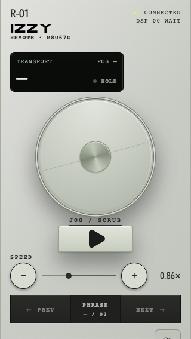

# Live remote finish review — 18 October 2026

Brief: verify every existing skin as a working remote, preserving the original
studies and their reproducible construction method. No new collection or release
was requested.

[Acceptance record, fixes, actual checks and remaining device gates](../../REMOTE_SKIN_QA.md)
· [Canonical construction playbook](../../REMOTE_DESIGN_PLAYBOOK.md)

The sixteen `*-paired.png` files are full-size Chromium captures at 390 × 844 CSS
px from the real paired online remote, paused at its initial display position and
0.86× speed. All sessions use synthetic text and mocked Pro appearance grants.
The captures contain no pairing keys. Browser emulation is not physical-device
acceptance. The composite below reduces these captures for comparison; use the
full-size links in the acceptance matrix for details and legibility review.

Artwork and source: the live paths in the playbook and the source revision of
this review PR. The founding and Material memory capsules remain unchanged and
pass their recorded hash checks. Functional, keyboard and reduced-motion results
are recorded separately from these still images.

Additional 320 × 568 keyboard-focus evidence: the jog cue clears the readout and
the separate Play key. This geometry check has no paired reading display, so its
position is correctly unavailable.

