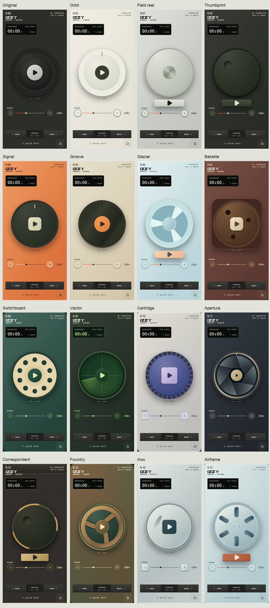
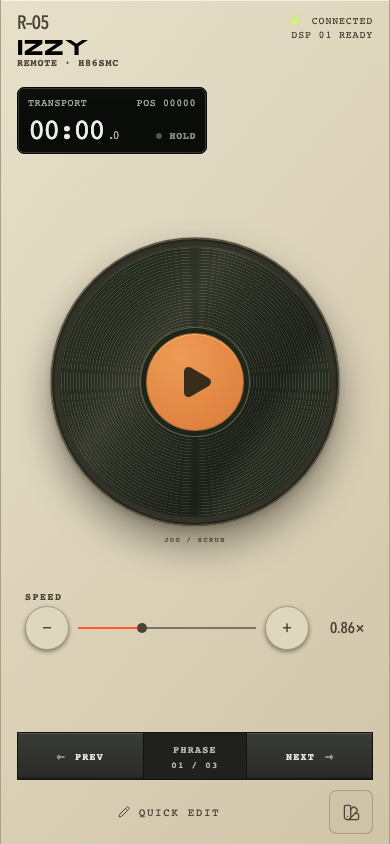
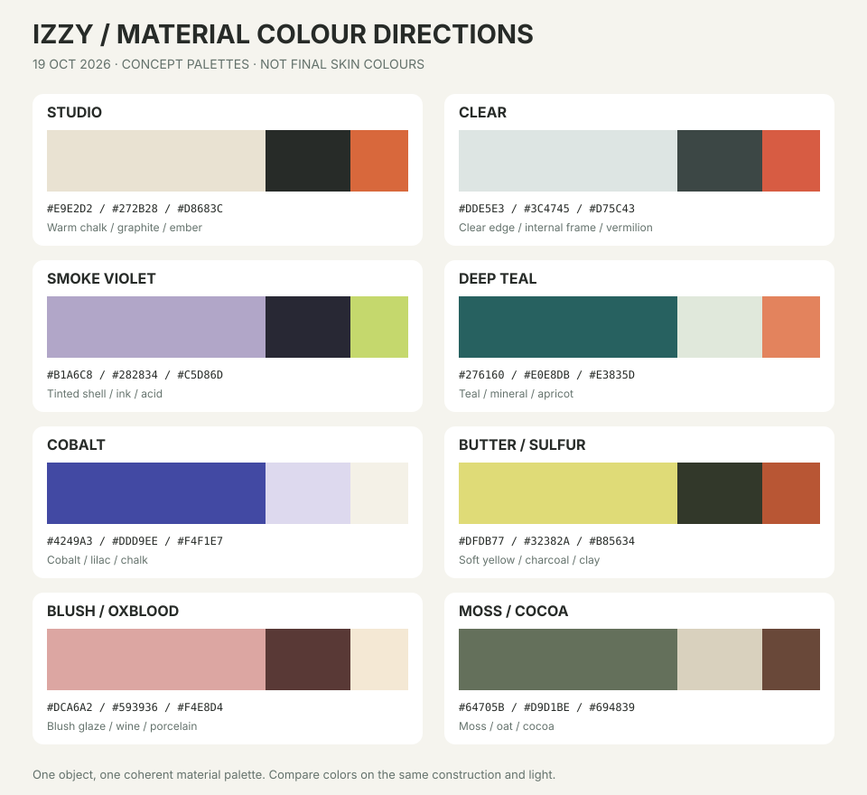
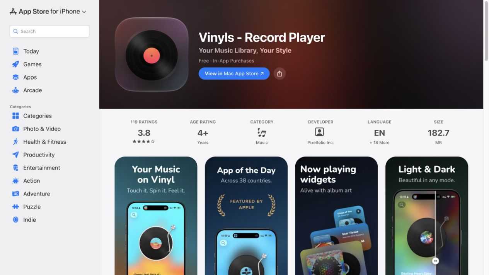
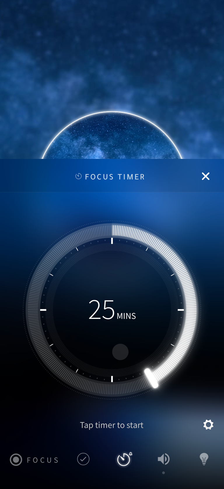
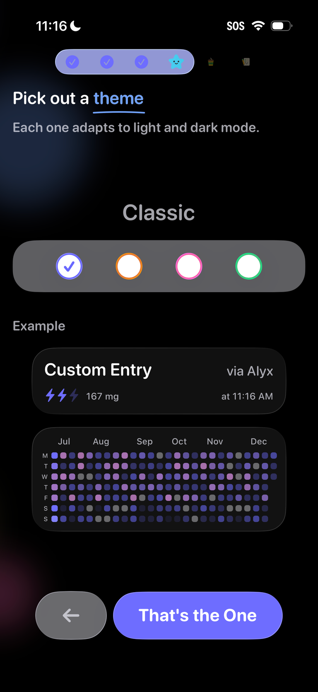
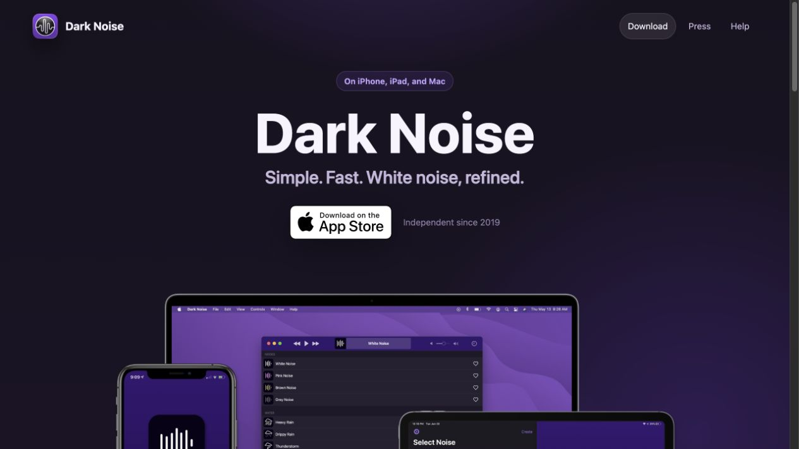

# IZZY: скины, которые хочется себе оставить

Исследование и план · 18 октября 2026 · Редакция 2: 19 октября 2026 · Статус: направление одобрено владельцем; реализация начата 19 октября. [Ход реализации и фактические проверки](../../SKIN_CRAFT_IMPLEMENTATION.md).

## Решение за минуту

Сначала сделать **Groove с работающим тонармом**, затем развить коллекцию через полноценные механизмы: лентопротяжку, диафрагму, ремни, ролики и связанные движущиеся узлы. **Прозрачный корпус — обязательное направление**: проектируем Clear и тонированный Spool, а не ограничиваемся матовым Glacier. Для расширения готовим шесть кандидатов: **Clear, Spool, Glaze, Pop, Moss и Mono**. Это путь с 15 до 21 PRO-скина, затем при отборе ещё четырёх — до 25. Бесплатный Original считается отдельно.

Главная возможность коллекции — ощущение дорогого, живого предмета, который интересно рассматривать и приятно запускать. Одна выразительная механическая сцена может включать несколько движущихся деталей. Принимаем это как продуктовую ставку владельца и проектируем смело; исследования помогут отбирать лучшие решения. Спокойные скины остаются частью разнообразия, а для характерных инструментов одних бликов и финишей недостаточно. Цветовая система соединяет основу IZZY с актуальными направлениями предметного дизайна.

## Уточнение владельца: прозрачность, механика, цвет

19 октября владелец одобрил план и добавил три требования:

1. Один или несколько дизайнов с прозрачным корпусом, референс — подход Nothing к видимой конструкции. Прозрачное семейство входит в основной план. Для первой подачи готовим два разных предмета; в итоговую коллекцию должен попасть минимум один полноценный прозрачный корпус.
2. Смелее с деталями: дополнительные движущиеся элементы, плёнка, механические взаимодействия, а не только изменение света и отделки. Это выбранный способ повысить привлекательность и воспринимаемую ценность продукта. Не требуется сначала доказывать право на такую выразительность интервью; тесты нужны для выбора исполнения и удобства.
3. Отдельно проработать цвет: актуальная индустриальная палитра в рамках характера IZZY, без перекрашивания всей коллекции в один «цвет года».

Это уточнение заменяет осторожные ограничения первой редакции на количество движущихся частей. Общий ввод, доступность и мгновенная отправка команды сохраняются. На момент подготовки редакции 2 прототипы ещё не были реализованы. Затем владелец поручил выполнить план; текущий статус — в отдельной записи реализации.

## Что исследовано и что пока неизвестно

В исходном исследовании 18 октября изучены каталог, CSS всех 16 вариантов, общие JogControls, useWheelMotion, RemoteInstrument, RemotePage, библиотека и продуктовые документы. Визуальная основа — сохранённая матрица настоящего парного remote от 18 октября; тогда дополнительно был открыт локальный `/lab/jog`, у Groove проверено переключение Play → Pause и просмотрено его рабочее состояние. Это наблюдение за демо, а не новый полный функциональный прогон.

Срез исходников: ветка `codex/remote-skin-readiness`, коммит `3a6bec9`. Этот отчёт находится в отдельной ветке `codex/skin-craft-research` от актуального `origin/main` (`7b035ac`). При последующей реализации сначала учесть интеграцию readiness-исправлений; не переносить старое поведение из main поверх них.

Внешняя часть первой редакции: официальные страницы Teleprompter.com, Vinyls, Dark Noise, Elgato, Teenage Engineering, Apple и W3C; шесть запросов к Lazyweb. Отобраны и просмотрены два точных мобильных примера. 19 октября добавлены текущие страницы Nothing, цветовая коллекция Apple 2026 года, прогноз Coloro/WGSN A/W 26/27 и исторический пример прозрачных корпусов Analogue. Источники показывают существующие решения и сценарии, **не структуру покупателей IZZY и не эффект на конверсию**. Интервью, проверка готовности платить и тесты физических телефонов в этой работе не проводились.

## Текущее состояние



*IZZY, сохранённое сравнение от 18 октября: реальные remote в Chromium при 390 × 844 CSS px, синтетический текст, тестовый PRO-доступ, пауза, скорость 0.86×. Снимки повторно использованы как исходная точка исследования. Не являются физическими проверками устройств.*

**Что уже удалось.** У коллекции есть собственный язык: крупный круг, корпус, материал, небольшой дисплей и ясная клавиша. Groove, Vector, Switchboard и Aperture читаются как разные идеи даже без названия. Orbit обеспечивает спокойный полюс; Signal — выразительный; Glacier и Cartridge уже дают более лёгкое настроение. Сохраняем эти различия и весь архив.

**Где перекос.** Много тёмных оливковых, металлических и винтажных инструментов. Field reel, Inox и Airframe различаются конструкцией, но находятся рядом по ощущению. Thumbprint и Correspondent родственны тёмным диском с углублением; Glacier, Foundry и Airframe родственны механическим колёсам с просветами. Это не повод удалять удачные работы — это причина выбирать следующие темы из других миров.

**Где есть запас качества.** Внешний вид в основном задают градиенты, тени и геометрия одного вращающегося слоя. Отдельной кинематики нет. Световые блики, нарисованные внутри ротора, вращаются вместе с ним; нужно поштучно проверить, какие из них являются свойством поверхности, а какие должны описывать неподвижный источник света. В миниатюрах корпуса и панели существенно отличаются от рабочего remote: деталь надо проверять на всех поверхностях, а не только на красивом объекте PRO-страницы.

## Приоритетный план

| Этап | Работа и результат | Условие перехода |
| --- | --- | --- |
| 1. Эталон Groove | Два визуальных эскиза размещения тонарма, выбор геометрии, один рабочий локальный прототип с полным набором состояний | В 320/390 px сразу видны Play и рабочая зона; поведение приятно при повторных нажатиях; владелец одобрил характер |
| 2. Механика и прозрачность | Field reel с лентой, Aperture с подвижной диафрагмой; Clear и Spool с видимой внутренней конструкцией. До полной полировки — короткие рабочие проверки движения | Минимум один полноценный прозрачный корпус в итоговом плане; вторичные узлы подчинены крупному jog и не меняют жест |
| 3. Вся коллекция и цвет | Остальные 12 PRO-скинов и бесплатный Original; механические детали по паспортам, согласованная цветовая система, миниатюры | Каждый скин сохраняет собственный характер; цвет проверен на реальном материале, в рабочем состоянии и при уменьшении |
| 4. Проверка покрытия | Шесть сопоставимых концептов Clear/Spool/Glaze/Pop/Moss/Mono, качественные сессии с потенциальными пользователями | Сравнение подбирает лучшие реализации; обязательная прозрачность не ставится на голосование |
| 5. Расширение | Реализовать прошедшие отбор направления: первая группа до 21 PRO, затем возможные 25 | Два прозрачных направления не сводятся к двум перекраскам; ещё четыре темы отбираются по характеру и качеству |
| 6. Показ и выпуск | Короткая демонстрация механизма на PRO, статичная библиотека во время дубля, staging и приёмка на устройствах | Проверки PR и физические проверки выполнены; публикация — после отдельного разрешения владельца |

Последовательность: `Groove → лента/диафрагма + Clear/Spool → общая полировка и цвет → шесть новых кандидатов → отбор → расширение`. Цветовую карту и геометрию прозрачных корпусов готовим с самого начала, поскольку они определяют конструкцию, а не добавляются последним слоем.

## Аудитория: сценарий работы × личный вкус

Пользователь телесуфлёра не обязательно интересуется аппаратурой. Роль помогает понять условия использования, а вкус — желание выбрать внешний вид. Нельзя выводить предпочтение к розовому, металлу или ретро из пола, возраста или профессии.

Teleprompter.com показывает сценарии контента, презентаций, вещания и управления со второго устройства; отдельный аудиорежим адресует подкасты, озвучку и обучение. Это полезные гипотезы набора участников исследования IZZY, а не измеренные сегменты нашего рынка. [Основной продукт](https://www.teleprompter.com/), [аудиосценарии](https://www.teleprompter.com/blog/audio-recording-teleprompter).

| Сценарий для проверки | Что человек пытается сделать | Что проверить у скинов |
| --- | --- | --- |
| Солоавтор: YouTube, короткие видео, UGC | Быстро начать и повторить неудачную фразу | Находит Play с первого взгляда; есть «мой» вариант без знания аппаратуры |
| Эксперт, преподаватель, автор курса | Спокойно записать длинное объяснение | Не утомляет через несколько минут; материал не спорит с состоянием |
| Подкаст, озвучка, интервью | Держать темп речи и быстро вернуться | Аналоговая метафора узнаваема; никакие звуки скина не попадают в запись |
| Ведущий, видеограф, оператор | Надёжно управлять дублем | Ясно различимы RUN/HOLD, фокус и недоступность; красота не мешает точности |

### Карта вкусов — редакционная оценка, не статистика

| Желание | Текущее покрытие | Что попробовать |
| --- | --- | --- |
| «Мой маленький студийный инструмент» | Сильное: Groove, Signal, Bakelite, Field reel | Углубить механизмы и материалы |
| «Точная вещь из металла» | Сильное: Inox, Airframe, Foundry, Field reel | Развести характер, не добавлять ещё один серебристый диск |
| «Люблю историю предмета» | Сильное: Switchboard, Correspondent, Groove | Сохранить узнаваемость, умерить декоративную ностальгию |
| «Хочу мягкий современный объект» | Частичное: Orbit, Glacier, Cartridge | Glaze: цветная глазурь и округлая конструкция |
| «Нравятся природные и домашние вещи» | Слабое: тёплая кожа есть, природного мира почти нет | Moss: спокойный древесный обод и минеральный корпус |
| «Хочу яркое и графическое» | Частичное: Signal, Cartridge | Pop: цветные сектора и самостоятельная плоская геометрия |
| «Мне не нужна имитация прибора» | Частичное: Orbit всё ещё керамический объект | Mono: ясный графический круг, минимум фактуры |
| «Хочу фантастический/игровой мир» | Частичное: Vector и Cartridge, без отдельной коллекции | Один кандидат в резерве; не вся следующая серия |
| «Хочу видеть устройство изнутри» | Полноценного прозрачного корпуса нет; Glacier передаёт матовый полимер | Обязательные Clear и Spool: разная конструкция под прозрачной оболочкой |

## Groove: первый образец глубины



*Текущий рабочий remote: канавки и центральная клавиша уже задают хороший образ. Тонарм пока отсутствует.*

Идея пользователя сильна, потому что добавляет недостающий **ритуал**: приготовил пластинку → нажал Play → игла встала → начался дубль. В [Vinyls](https://apps.apple.com/us/app/vinyls-record-player/id1556054655) есть цифровая пластинка, тонарм и перемотка диском; это прямой пример воплощения метафоры. Копировать его графику не требуется.

### Устройство

Точка крепления сверху справа, за внешним краем диска. Неподвижное основание, противовес, тонкая трубка с одним изгибом, головка и маленькая видимая игла. Поднятое и опущенное положения различаются небольшой тенью и высотой головки. Рядом — скромная парковочная опора. Достаточно этих деталей; дополнительные винты и шкалы должны оправдать своё место.

```text
ПАУЗА                         ВОСПРОИЗВЕДЕНИЕ
     крепление ●                    крепление ●
               │                              ╲
   ╭────────╮  ◇ парковка          ╭────────╮   ╲
   │ винил  │                      │ винил ◇ ← игла
   │   ▶    │                      │   Ⅱ    │
   ╰────────╯                      ╰────────╯
```

Сначала сравнить прямой и мягко изогнутый тонарм на существующем корпусе. Не уменьшать колесо ради механизма. Если узкая компоновка требует уступки, упрощаем противовес и основание, сохраняя узнаваемые трубку и головку. Центральная клавиша остаётся неподвижной и доступной; тонарм до неё не доходит.

### Контракт состояний

| Состояние | Тонарм и пластинка | Что происходит с управлением |
| --- | --- | --- |
| HOLD / Pause | Тонарм поднят и припаркован, диск стоит в достигнутом угле | Play готов сразу |
| Нажат Play | Тонарм поворачивается к внешней дорожке и опускается | Команда отправляется немедленно, не после анимации |
| RUN | Игла на дорожке, диск вращается; основание и корпус неподвижны | Скорость и семантика общие для всех скинов |
| Нажат Pause | Игла поднимается и тонарм уходит на опору; диск останавливается согласно действующему мотору | Пауза без декоративной задержки |
| Ручной scrub | Небольшое поднятие головки; движение диска точно следует общему жесту | Не добавляем инерцию, сопротивление и новые команды |
| Конец scrub | Из RUN головка возвращается на дорожку; из HOLD тонарм остаётся припаркован | Pointer cancel не оставляет промежуточное состояние |
| Быстрые Play/Pause | Незавершённый переход меняет направление из текущего положения | Нет очереди анимаций и блокировки клавиши |
| Нет связи / controls disabled / Quick Edit | Игла поднята, движение остановлено; существующее уведомление объясняет причину | Положение тонарма не обещает готовность или соединение |
| Возврат связи / смена скина в RUN | Сразу показать актуальное состояние и затем обычное движение | Не проигрывать ритуал запуска заново, если чтение уже идёт |
| Reduced motion | Состояния меняются сразу; без вращения и перелёта | Play/Pause, scrub и показания работают полностью |

Парковка на Pause — намеренная интерпретация по запросу владельца. У физического AT-LP60X возврат тонарма связан со STOP, а подъём — отдельная операция; не выдаём нашу модель за универсальную механику любого проигрывателя. [Руководство Audio-Technica](https://docs.audio-technica.com/eu/AT-LP60X_UM_162501370_V2_EN_web_190502.pdf).

Начальные гипотезы для прототипа: 240–360 мс на поворот и 80–120 мс на небольшой подъём/опускание, без пружинного отскока. Значения подбираются по наблюдению, это не результаты измерений. Переход должен быть обратимым в любой момент. Направленность движения и прерываемость согласуются с принципами [Apple: Designing Fluid Interfaces](https://developer.apple.com/videos/play/wwdc2018/803/).

**Не включать в первую версию:** постепенное продвижение иглы к центру как якобы точный прогресс. Нынешний угол ротора — декоративный, а координата текста зависит от компоновки и правок. Для честного индикатора прогресса сначала понадобится отдельный определённый источник значения. Также не переносим RPM 33/45 в интерфейс: текущая скорость вращения условная, не скорость настоящего проигрывателя.

Никакого нового треска пластинки или механических щелчков: IZZY используется рядом с записывающим микрофоном. Уже существующую вибрацию не дублируем механизмом скина. Тонарм декоративный, не получает фокус и не перехватывает касания. Канавки отдельно проверить на муар при разных DPR и масштабе.

## Паспорт полировки каждого скина

Это авторские предложения после просмотра текущей матрицы и исходников. «Проверить» ниже означает предстоящую работу, а не обнаруженную и воспроизведённую неисправность. P1 — пилот и самые характерные предметы, P2 — общий проход качества; оба этапа обязательны для финального комплекта.

| Скин | Что сохранить | Деталь следующего уровня | Поведение и критерий качества | Очередь |
| --- | --- | --- | --- | --- |
| Original · free | Знакомую насечку и светлую клавишу | Чёткая граница грип/диск, единый источник света и глубина нажатия | Полноценный красивый базовый пульт; не ухудшать ради продажи PRO | P2 |
| Orbit · R–03 | Спокойную керамику и большую чистую окружность | Тонкий шов керамического кольца, мягкая тень посадки тёмной клавиши | Удовольствие от пропорций в неподвижном виде; без обязательного нового механизма | P2 |
| Field reel · R–01 | Широкий сатиновый диск, отдельный Play | **Лента от основной катушки через небольшой ролик и прижим к вспомогательной ступице**; проработанный путь ленты | На RUN лента идёт, на HOLD стоит, при scrub следует направлению jog; малая катушка остаётся вторичной по размеру | P1 |
| Thumbprint · R–02 | Единственную пальцевую выемку и грип | Правильный внутренний свет/затенение кармана, аккуратная насечка по окружности | Выемка принадлежит диску и движется с ним; без дополнительного вращающегося указателя | P2 |
| Signal · R–04 | Оранжевую эмаль и кремовую квадратную клавишу | **Механический флажок RUN/HOLD** в небольшом прорезном окне, короткий ход клавиши | Флажок переключается вместе с реальным состоянием; не создаёт ещё одну кнопку и не обозначает запись | P2 |
| Groove · R–05 | Винил, тёплый корпус, оранжевую середину | **Тонарм с головкой, иглой и парковочной опорой** | Полный контракт состояний выше; не крадёт рабочий сектор диска | P1 |
| Glacier · R–06 | Три светлые спицы и персиковую клавишу | **Видимый через матовый обод приводной ремень и малый ролик**; неподвижные внутренние рёбра | Толщина оболочки и расстояние до внутренних узлов видны; остаётся frosted-родственником, а не заменой обязательного Clear | P2 |
| Bakelite · R–07 | Смолу, квадратную нишу, фарфоровую клавишу | Литейный шов и тёплая глубина у края; отверстия выглядят выемками | Квадратная ниша стоит, круг вращается; тональность не прячет Play | P2 |
| Switchboard · R–08 | Десять телефонных колодцев и petrol/ivory | **Неподвижный упор для пальца** за краем колеса, убедительная толщина отверстий | Упор декоративный: не ограничивает круговой жест; без пружинного возврата и цифр как новых функций | P1 |
| Vector · R–09 | Свечение под фиксированной сеткой | **Разделить стекло, сетку и светящийся луч по глубине**; короткий мягкий хвост | Хвост связан с направлением вращения, не разворачивается неверно при scrub назад; без случайных целей и фальшивой телеметрии | P1 |
| Cartridge · R–10 | Ультрамариновые рёбра и лавандовую клавишу | **Небольшое кассетное окно: два шпинделя и проходящая лента**, сдвиг прижимного узла на Play/Pause | Окно вторично к главному shuttle; на паузе лента стоит, при scrub меняет направление. Кассета не «извлекается» посреди дубля | P2 |
| Aperture · R–11 | Шесть оптических плоскостей и champagne-центр | **Действующая диафрагма с ходом лепестков**; второй эскиз — короткое окно перфорированной киноплёнки у края корпуса | На Play раскрытие, на Pause частичное закрытие вокруг всегда видимой клавиши; сравнить чистую диафрагму и версию с плёнкой, отобрать цельный предмет | P1 |
| Correspondent · R–12 | Кожу, латунь и единственную пальцевую лунку | **Короткий ход рычага затвора у отдельной клавиши**; износ только на выступающих кромках | Рычаг отвечает на Play/Pause, а не имитирует съёмку; не возвращать удалённую вторую метку | P2 |
| Foundry · R–13 | Трёхлучевую отливку, бронзу, recessed patina | **Частично видимая ведомая шестерня в боковом вырезе**, сцепленная с основным колесом | Направление и передаточное отношение согласованы, зубья не проскальзывают; визуальный вес без задержки ввода | P2 |
| Inox · R–14 | Чистую сталь, канал под палец и тёмную клавишу | **Убедительное направление шлифовки**, микрофаска и аккуратный стык | Отдельно проверить свет и вращение фактуры. Именно точность, без дополнительной анимации | P2 |
| Airframe · R–15 | Шесть облегчённых прорезей и отдельную рыжую клавишу | Толщина стенок прорезей, тень внутренней полости, понятное крепление ступицы | Прорези остаются геометрически замкнутыми при любом угле; не становиться ещё одним Inox | P2 |

Для Orbit есть конфликт истории решений: brief от 15 октября требует убрать оранжевый индекс, readiness от 18 октября описывает его восстановление. В этом исследовании он не меняется. Перед полировкой зафиксировать один актуальный визуальный эталон по выбору владельца, не «исправлять» его автоматически по старому документу.

Общий критерий после уточнения владельца: **одна цельная механическая сцена; столько связанных движущихся частей, сколько делает её убедительной**. Тонарм с шарниром и подъёмником, лента с роликами и прижимом, ремень с ведомой ступицей — полноценные кандидаты. Часть спокойных скинов остаётся спокойной; механизмы не обязаны быть у всех одинаковыми.

## Обязательное прозрачное семейство

Референс Nothing важен конструкцией: оболочка открывает расположение внутренних элементов, глубину и сборку. Официальные описания [Headphone (1)](https://nothing.tech/products/headphone-1) и [Headphone (a)](https://nothing.tech/products/headphone-a) описывают прозрачный корпус и видимые внутренние узлы. Берём принцип открытой инженерии, создавая собственную компоновку IZZY. Здесь нет предложения сотрудничества, использования логотипа или воспроизведения фирменной Glyph-графики.

**Clear — светлая открытая конструкция.** Прозрачная жёсткая оболочка с молочной кромкой; внутри светлая несущая рама, тёмный узел jog, приводной ремень, малый шкив и один оранжево-красный элемент. Видны стенки корпуса, посадочные стойки, короткий шлейф к клавише. Во время RUN движется привод, на Pause мягко переходит прижимной узел; корпус, рама и электроника остаются на месте. Не заполнять всё пространство случайными платами и винтами.

**Spool — тонированный прозрачный лентопротяжный предмет.** Дымчато-фиолетовая или янтарная оболочка, большая катушка как jog, небольшая ведомая катушка и видимый участок плёнки/ленты через два направляющих ролика. Есть глубина до опорной плиты, видны края катушек и перфорация у плёночной версии. На RUN лента движется, на Pause прижим приподнимается, при ручном scrub она следует направлению. Цветная прозрачность становится частью материала, а не цветным наложением поверх любого скина.

Это разные конструкции, не два цвета одной формы: Clear раскрывает современный привод, Spool — тракт прохождения ленты. [Analogue Pocket Transparent Editions](https://www.analogue.co/editions/pocket-transparent) полезен как исторический пример цветных прозрачных оболочек; сам по себе он не доказывает тренд 2026 года.

### Что делает корпус прозрачным

Читаемый стек слоёв: внешняя стенка и её толщина → воздушный зазор → неподвижная рама и опоры → подвижные узлы → нижняя плита. Рёбра на обороте частично перекрываются внутренними деталями; блик идёт по поверхности оболочки. Текст, пиктограммы и критический дисплей имеют непрозрачные опорные площадки. Простого `opacity` для всего корпуса недостаточно: оно обесцветит текст и не создаст конструкцию.

В 320 px должны остаться видимыми хотя бы край оболочки, один внутренний узел и зазор между ними. В миниатюре можно убрать мелкие винты и дорожки, но сохранить характерный тракт и кромку. Для первой версии не нужны WebGL и отслеживание наклона телефона: глубину можно собрать SVG/CSS, а движение выполнить лёгкими трансформациями.

## Механические сцены: правила движения

Основной jog сохраняет крупный размер и ввод. Вторичные катушки, шестерни и ролики берут движение от его угла/дельты через заданное отношение, а не запускают независимые несвязанные циклы. Для непрерывной ленты используется повторяемая фактура и согласованный сдвиг; на ручном вращении направление сразу меняется. Рост/убывание намотки, точные секунды, метры плёнки и кадры не рисуются без определённого источника значения.

| Элемент | Play / RUN | Pause / HOLD | Ручная перемотка |
| --- | --- | --- | --- |
| Тонарм Groove | Подходит и опускает иглу | Поднимается и паркуется | Головка немного поднята; диск идёт за рукой |
| Лента Field reel / Cartridge | Движется через ролики; прижим в рабочей позе | Стоит; прижим отведён коротким ходом | Ролики и лента следуют тому же направлению без проскальзывания |
| Диафрагма Aperture | Лепестки раскрываются вокруг центральной клавиши | Частично закрываются; клавиша остаётся открытой | Ротор по-прежнему идёт за рукой; диафрагма не меняет чувствительность |
| Привод Clear / Glacier | Ремень и ведомый шкив согласованы | Остановка на текущем угле | Передаточное отношение сохраняется в обе стороны |
| Шестерня Foundry | Вращается противоположно ведущему зубчатому венцу | Стоит | Зубья остаются в зацеплении при реверсе |
| Флажок Signal / рычаг Correspondent | Переход в рабочую позу | Возврат в позу HOLD | Не создаёт дополнительных режимов |

Все переходы обратимы при быстрых нажатиях; декоративный узел не задерживает команды. При потере связи механика не продолжает обещать RUN. В библиотеке сохраняются статичные карточки, в PRO и крупном просмотре показывается выразительный рабочий цикл. Reduced motion оставляет статичные позы и весь доступный ввод. Несколько движущихся частей разрешены; проверяется их общий расход ресурсов на телефоне.

## Цвет: актуальные сигналы и палитры IZZY

### Что видно в индустрии на 19 октября 2026

- **Цвет как часть предмета, включая прозрачный.** У Nothing Headphone (a) чёрный и белый дополнены розовым и жёлтым; описание связывает оболочку с видимой конструкцией. Это хороший сигнал, что открытая инженерия может быть эмоциональной и цветной. [Nothing](https://nothing.tech/products/headphone-a).
- **Мягкий розовый, насыщенный синий и цитрусовый рядом с металлом.** В мартовском выпуске MacBook Neo 2026 Apple использует blush, indigo, silver и citrus, согласуя оттенки корпуса и клавиатуры. Для IZZY полезен принцип цельной палитры объекта. [Apple](https://www.apple.com/newsroom/2026/03/say-hello-to-macbook-neo/).
- **Глубокий teal, тёплые землистые и синтетические акценты.** В прогнозе Coloro/WGSN A/W 26/27 соседствуют Transformative Teal, Wax Paper, Fresh Purple, Cocoa Powder и Green Glow. Это прогнозная палитра широкой индустрии дизайна, а не рейтинг продаж интерфейсов. [Coloro](https://coloro.com/key-colors).

Вывод для IZZY — тёплые нейтрали и тёмная инструментальная основа плюс продуманный ряд цветных материалов. Никакой один источник не определяет «правильные цвета для всех»; ниже собственные стартовые сочетания, не официальные HEX брендов или Coloro.



| Палитра | Корпус / основная поверхность | Второй материал / опора | Акцент | Где исследовать |
| --- | --- | --- | --- | --- |
| Studio | Тёплый chalk `#E9E2D2` | Graphite `#272B28` | Ember `#D8683C` | Сохранить родство Groove/Orbit/Signal, базовый язык IZZY |
| Clear | Холодная прозрачная кромка `#DDE5E3` | Тёмный механизм `#3C4745` | Vermilion `#D75C43` | Светлый Clear; прозрачность строится слоями, не одним цветом |
| Smoke Violet | Дымчатый фиолетовый `#B1A6C8` | Ink `#282834` | Acid `#C5D86D` | Тонированный Spool; цветная оболочка и тёмные внутренние узлы |
| Deep Teal | Глубокий teal `#276160` | Mineral `#E0E8DB` | Apricot `#E3835D` | Альтернатива для прозрачного семейства; не перекрашивать автоматически Vector |
| Cobalt | Синий `#4249A3` | Lilac `#DDD9EE` | Chalk `#F4F1E7` | Развить Cartridge и графический Pop |
| Butter / Sulfur | Мягкий жёлтый `#DFDB77` | Charcoal `#32382A` | Clay `#B85634` | Pop или цветной Clear; проверить на цельном корпусе |
| Blush / Oxblood | Приглушённый blush `#DCA6A2` | Тёмное вино `#593936` | Porcelain `#F4E8D4` | Glaze: цвет воспринимается через глазурь и профиль края |
| Moss / Cocoa | Сложный зелёный `#64705B` | Oat `#D9D1BE` | Cocoa `#694839` | Moss и тёплые ремесленные поверхности |

Восемь палитр не означают восемь новых скинов. Для Clear/Spool сравнить нейтральную и цветную оболочки; затем выбрать по одной сильной комплектации на конструкцию. Для остальных — подобрать подходящий материалу вариант, сохранив узнаваемость существующей коллекции.

### Что удерживает палитру в продукте

IZZY-orange остаётся узнаваемым акцентом в общей подаче продукта; внутри отдельных скинов акцент может быть кобальтовым, лиловым или цитрусовым. Не нужно навязывать оранжевый каждой вещи. Показания, подписи и фокус получают контрастную опору; декоративный акцент не становится автоматически цветом мелкого текста. Статусы связи остаются различимыми по тексту и форме. Прозрачные детали проверяются на своей нижней плите, а не на случайном фоне страницы.

Для каждого эскиза сравнить один и тот же корпус/механизм в двух палитрах при одинаковом свете. Проверить большой объект, 390/320 px и миниатюру; RUN/HOLD, фокус и reduced motion. HEX выше — отправная точка цветовых проб, контраст этих полных скинов ещё не измерен. Материалы и цвета будут уточняться вместе, без массовой перекраски уже понравившихся вариантов.

## Расширение: шесть основных и четыре резервных мира

Названия рабочие, это концепт-карточки, не обещание готовых или включённых в PRO скинов. Новые stable ID и номера присваиваются только после отбора; существующие не перерабатываются в новые темы.

| Направление | Зачем в коллекции | Конструкция и сигнатура | Отличие от ближайшего текущего | Отбор |
| --- | --- | --- | --- | --- |
| **Clear** | Обязательная открытая инженерия и прозрачный корпус | Видимая рама, ременной привод, малый шкив, прозрачная стенка с толщиной | Не матовый Glacier: ясно читаемая оболочка и внутренняя конструкция | Основная шестёрка; прозрачное семейство обязательно |
| **Spool** | Второй самостоятельный прозрачный предмет и механическая сцена с плёнкой | Тонированная оболочка, большая катушка, малая ведомая и лентопротяжный тракт | Не Clear другой расцветки и не непрозрачный Field reel: другая архитектура и путь ленты | Основная шестёрка |
| **Glaze** | Мягкий, цветной, современный предмет без ностальгии | Глазурованная керамика; выпуклая площадка с тонким неглазурованным основанием, округлая клавиша | Не перекраска Orbit: иной профиль края, посадка и отношение колеса к корпусу | Основная шестёрка |
| **Moss** | Природное, домашнее и спокойное | Матовый минеральный корпус; неглубокий деревянный обод с торцевым рисунком, лаконичная клавиша | Вместо состаренной камеры Correspondent — новый бытовой предмет, без латунной патины | Основная шестёрка |
| **Pop** | Графическая радость и цвет вне аппаратуры | Плоские цветные сегменты, широкая рамка и контрастная геометрическая клавиша; один сегмент помогает видеть поворот | Не цвет Cartridge: без ретрорёбер и имитации ABS-механизма | Основная шестёрка |
| **Mono** | Выбор для тех, кому не нужна имитация материала | Тёмный матовый графический диск, один широкий разрыв окружности, большая светлая клавиша | Не Original/Thumbprint: нет насечки, выемки и глубокой приборной фактуры | Основная шестёрка |
| Loom | Тёплая тактильность другого рода | Текстильный неподвижный корпус и гладкий диск; тканевый кант | Не кожа Correspondent; опасность муара и визуального шума | Резерв |
| Arcade | Выразительный игровой предмет | Крупные функционально читаемые формы и пластичная клавиша; точный отклик на нажатие | Отличать от Cartridge: не VHS и не рёбра. Без игровых очков и новых действий | Резерв |
| Observatory | Ночная точная механика | Нейтральный астрономический лимб и перекрывающиеся кольца, без ложных измерений | Отличать от Vector: без радара, сканирования и зелёного фосфора | Резерв |
| Rally | Спортивное, собранное и энергичное | Резиновый грип, крупная графическая риска и контрастный корпус | Не Signal другого цвета: другая структура захвата и геометрия клавиши; без фальшивого тахометра | Резерв |

Не включать автоматически: второй близкий металл, десяток перекрасок, сезонные картинки и брендовые наклейки. Сотрудничества с брендами можно изучать отдельно, когда будет реальный бриф. Сначала самостоятельная идентичность IZZY.

Новый кандидат проходит три фильтра: отличается минимум по трём осям (материал/геометрия/свет/палитра/расположение Play/характер движения), узнаётся без имени и нравится хотя бы части людей, которым не подходит текущая коллекция. Последний пункт — исследовательская цель, а не уже полученный результат.

## Референсы: что берём и что оставляем у источника



**[Web, текущая страница] Vinyls.** В промоскриншотах видны пластинка и тонарм; описание подтверждает их связь с воспроизведением и перемоткой. Берём полноту аналогового ритуала. Не переносим чужие формы, звуки и модель платного доступа. Снимок страницы не заменяет личную проверку поведения установленного приложения. [Источник](https://apps.apple.com/us/app/vinyls-record-player/id1556054655).



**[Lazyweb, архив, mobile] Portal.** Крупный круг, ясно выделенная текущая величина и ограниченная яркая зона. Берём понятную композицию механизма. Его шкала означает длительность; не переносим такую шкалу в IZZY без определённого значения. Снимок подтверждает внешний вид, а не удобство жеста или производительность.



**[Lazyweb, архив, mobile] Alyx.** Выбор темы показан на реальных элементах интерфейса, видна выбранная палитра. Берём принцип «видеть результат до выбора». Не переносим дополнительное подтверждение в текущую библиотеку IZZY: её выбор одним касанием сохраняется. В PRO можно дать крупный демонстрационный remote; действующая библиотека во время дубля остаётся статичной.



**[Web, текущая страница] Dark Noise.** Спокойная подача продукта и узнаваемое оформление; в официальном описании App Store темы и анимированные значки — часть персонализации. Берём сочетание характера и ненавязчивого ежедневного использования. Лендинг не доказывает качество каждой темы, ценность анимации или рост продаж. [Сайт](https://darknoise.app/), [описание продукта](https://apps.apple.com/us/app/dark-noise/id1465439395).

**[Web, текстовый референс] Teenage Engineering TP–7.** Производитель описывает моторизованный диск одновременно как средство scrubbing и обратную связь во время работы. Для IZZY ценен этот союз механики и функции; мы не добавляем возможности физического устройства, которых у нашего протокола нет. [Источник](https://teenage.engineering/products/tp-7).

**[Web, текстовый референс] Elgato Stream Deck.** Официальная библиотека персонализации позволяет искать по стилю, теме и цвету. Вывод для IZZY: расширять набор по нескольким независимым вкусам. Фильтры для маленькой коллекции не обязательны; при 25 проверить, нужны ли компактные группы вместо усложнения библиотеки. [Источник](https://www.elgato.com/us/en/explorer/products/stream-deck/customize-stream-deck-with-icons-and-icon-packs/).

**[Web, текстовый референс] Apple Watch.** Каталог циферблатов показывает разные способы выражения одного назначения. Это пример разнообразия, не образец монетизации IZZY. [Каталог](https://support.apple.com/guide/watch/faces-and-features-apde9218b440/watchos).

### Качество поиска

Lazyweb: `app appearance theme picker`, `music player vinyl turntable`, `watch face gallery`, `meditation timer themes`, `turntable player` с компанией Vinyls, `theme selection` с фильтром dark-noise. Последний запрос вернул другие компании: этот фильтр не считаем подтверждением источника Dark Noise. Watch face дал слабые и нерелевантные результаты. Найденный в базе Vinyls — экран калибровки коллекционного приложения, а не доказательство тонарма у одноимённого плеера; отклонён. Не включены общие страницы Light/Dark/System и посторонний онбординг.

Два сохранённых мобильных примера проверены по visionDescription и лично по изображению. Portal: similarity 0.43, matchCount 1; Alyx: 0.93, matchCount 1. Их используем только для узких видимых принципов, не как сильное подтверждение рыночной гипотезы. Точное происхождение — в `sources.json`, без временных подписанных URL. Два из четырёх визуальных внешних референсов — мобильные экраны; ещё один — веб-страница с мобильными скриншотами.

## Как понять, что это повышает ценность

### 1. Качественная проверка до расширения

Набрать 12–16 людей, недавно записывавших подготовленную речь: солоавторы, эксперты/преподаватели, аудиоавторы и люди из видеопроизводства. Включить и любителей аппаратуры, и тех, кому она безразлична. Это небольшой направляющий набор, не репрезентативная статистика. Никому не отправлялись приглашения в рамках этого задания.

1. Показать текущую коллекцию без историй происхождения, порядок перемешать. Можно выбрать три, один или **«ничего для меня»**. Зафиксировать причины и близкие дубликаты.
2. Сравнить старый Groove, отполированный неподвижный Groove и тот же вариант с тонармом. Чередовать порядок. Так отделяем качество картинки от ценности движения.
3. На телефоне выполнить одинаковый короткий дубль: Play, пауза, возврат на фразу, скорость, ещё Play. Спросить про ощущение после работы, а не только первый «вау».
4. Показать шесть новых миров в сопоставимом размере и качестве, перемешивая порядок. Отдельно сравнить две палитры одного предмета, не меняя одновременно геометрию и цвет. Проверить, находят ли свой вариант прежде неудовлетворённые участники. Не сравнивать готовый Groove с грубым эскизом Mono. Прозрачность — принятое требование, участники помогают выбрать её исполнение.
5. Показать действующее предложение PRO целиком по одной и той же цене и спросить о выборе и причине. Не подсказывать «это ведь стоит купить». Разделить желание скина и ценность других функций PRO.

Результат: таблица индивидуальных выборов, повторяющиеся причины, ошибки управления, выбранный скин для следующего дубля. Числа вида «4 из 12» сообщать именно как результаты этих сессий, без перевода в долю рынка. Решение о новых мирах принимает владелец по совокупности причин, а не по псевдоточному общему баллу.

### 2. Проверка реальных покупок, когда продажа доступна

В проекте уже предусмотрены `pro_page_viewed`, `skin_previewed`, `pro_checkout_clicked`, `pro_purchase_completed`. Сначала проверить фактическое подключение сбора и пригодность данных. Клиентское событие покупки не считать финансовым источником истины: итог сверять с подтверждённым сервером доступом/платежами. Счётчики событий не дают автоматически воронку уникальных посетителей.

Первый эксперимент: та же PRO-страница, цена, набор скинов и источник трафика; меняется только демонстрация Groove. Основная метрика — подтверждённые покупки на доступный для покупки визит; диагностические — просмотр демонстрации и переход к покупке. Ограничители — ошибки, скорость страницы, успешный первый запуск, жалобы на движение. Размер выборки и срок определить по реальному трафику и базовой конверсии; заранее зафиксировать правило остановки. Не обещаем uplift в процентах.

Второй эксперимент, только после первого: достаточность 15 против расширенного набора. Не менять одновременно количество, цену, герой-скин и текст предложения. Если трафика недостаточно для различимого эффекта, честно опираться на качественные сессии и не объявлять доказанный рост продаж. Возможность выбора «мой скин» и повторный выбор после реального дубля — полезные ранние сигналы, но не замена покупке.

## Реализация: одна система, несколько инструментов

Предлагаемый путь, без изменения протокола и entitlement:

1. Общий JogControls по-прежнему обрабатывает ввод. Добавить инертный слой декоративных деталей и явные визуальные состояния на корне: доступность, playing, dragging. Семантика Play, скорость и направление одинаковы.
2. Визуальный слой использует текущее представление transport, включая уже существующий быстрый локальный отклик; подтверждение сервера и восстановление корректируют его. Не заводить второй «таймер воспроизведения» внутри тонарма.
3. Короткие движения — CSS/WAAPI по transform/opacity. Текущий useWheelMotion уже останавливает непрерывное вращение вне экрана, в фоне и при reduced motion. Сохраняем эти ограничения; после возврата показываем актуальную позу без очереди старых переходов.
4. Ротор, неподвижная оптика/свет, неподвижная база и подвижный тонарм — разные слои. SVG/CSS локальные, `aria-hidden`, `pointer-events: none`, без новых интерактивных зон.
5. RemoteInstrument и настоящий remote используют одну геометрию декора. В библиотеке — статичная поза. В демонстрации PRO можно явно запускать короткий цикл Play/Pause; существующее спокойное ambient-вращение декоративных объектов не означает реальную сессию.
6. Не размножать artwork независимо в lab и продукте. После согласованного прототипа перенести в общий визуальный модуль, сохранив архивы и отдельное демосостояние lab. Регрессию миниатюр проверять отдельно.

Для лент, шестерён и ремней добавить единый источник визуального угла/дельты: WAAPI/CSS для воспроизведения и немедленное обновление при ручном scrub. Декоративные узлы синхронизированы, но не создают собственных команд. Нельзя заставлять React перерисовывать весь пульт на каждом кадре.

Первые затрагиваемые области: `src/components/JogControls.tsx`, `src/components/useWheelMotion.ts`, `src/components/RemoteInstrument.tsx`, `src/product/skins.css`, инертные локальные SVG и существующая readiness-матрица. В API, платёжном коде и контроллере сессии изменений для тонарма не требуется.

## Приёмка: красота в настоящем дубле

Для каждого скина хранить три вида доказательств: неподвижный крупный план, короткую запись поведения и результаты работы парного remote. Красивый рендер не заменяет интерактивный тест.

| Область | Что требуется |
| --- | --- |
| Материал | Один согласованный свет, объяснимые стыки/тени, без муара; отличается при скрытом имени и в миниатюре |
| Состояния | Pause, Run, drag в обе стороны, cancel, быстрая смена состояния, disabled, Quick Edit, reconnect, смена скина в Run |
| Ввод | Отдельные доступные jog и Play, все клавиши, края зон касания, прежняя скорость и одинаковая перемотка |
| Размер | 320 × 568, 390 × 844, landscape 844 × 390, iPad portrait/landscape и desktop; zoom/увеличенный текст |
| Доступность | Контраст текста и значимых элементов, видимый фокус, не только цвет для состояния, reduced motion; реальные VoiceOver/TalkBack |
| Производительность | Нет непрерывного рендера React из-за декора; нет циклов в закрытой библиотеке/фоне; сравнить длинный дубль с текущей версией на том же телефоне |
| Поверхности | Lab, live remote, PRO-крупный объект, маленький тизер, карточка библиотеки — без исчезнувших деталей и ложного состояния |

44 × 44 CSS px — домашний ориентир IZZY для основных касаний, соответствующий enhanced-критерию AAA, а не универсальный минимум AA. Контраст: 4.5:1 для обычного текста, 3:1 для крупного; для существенных нетекстовых элементов — применимый 3:1. Это инженерная база, не сертификат полной доступности. [Размер целей](https://www.w3.org/WAI/WCAG22/Understanding/target-size-enhanced.html), [текст](https://www.w3.org/WAI/WCAG22/Understanding/contrast-minimum.html), [нетекстовый контраст](https://www.w3.org/WAI/WCAG22/Understanding/non-text-contrast.html).

Декоративное движение должно отключаться без потери возможности работать. При reduced motion остаются понятные статичные позы; вращение и перелёт иглы не становятся единственным индикатором. [W3C: animation from interactions](https://www.w3.org/WAI/WCAG22/Understanding/animation-from-interactions.html).

После изменения кода: текущие unit/build, соответствующие browser readiness и library-регрессии; целевой тест новых переходов тонарма, а не тестирование каждого CSS-свойства. Проверить неизменность двух сохранённых архивов. Перед merge — реально успешные GitHub `test`, `accounts`, `container`. Перед выпуском — staging по release runbook и физические устройства. В исследовательском этапе тестовые наборы не запускались: тогда код приложения не менялся. Новые результаты реализации фиксируются отдельно.

## Первое следующее задание

**Спроектировать и реализовать один Groove с тонармом по контракту выше.** Одновременно подготовить компоновки Clear/Spool и цветовые пробы из новой карты, чтобы следующий шаг уже включал обязательную прозрачность и видимую механику. Сохранить исходный вид, показать два варианта размещения, собрать один выбранный механизм, сопоставить до/после на телефоне и в PRO-крупном плане. После визуального и функционального разбора зафиксировать уровень качества как образец для остальных.

Исследовательский этап закончился планом без изменений приложения и hosted-сред. Последующая реализация выполняется по отдельному поручению владельца и описана в записи реализации; публикация требует отдельного решения.
