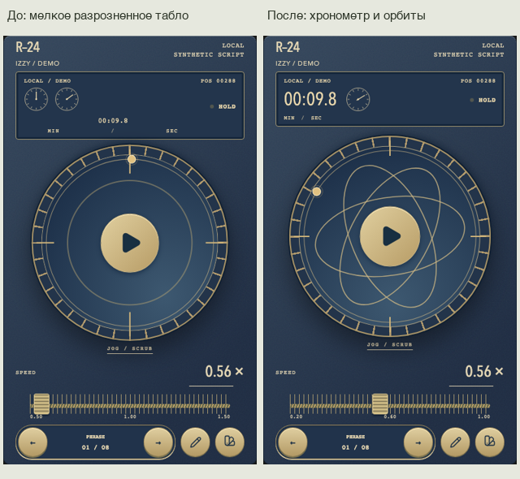

# Завершающий аудит выбранных 14 · 20 October 2026

[Галерея и замечания](http://127.0.0.1:8780/2026-10-20-final-audit/review.html) · [Observatory](http://127.0.0.1:8780/2026-10-20-final-audit/live/index.html?skin=observatory)

## Область и вывод

Проверены только14 ранее выбранных пультов. Исторические ID сохранены для совместимости, исключённые дизайны не возвращались. Для базового набора этого достаточно:10 тематических якорей и4 спокойные альтернативы (Field Reel, Orbit, Thumbprint, Original). Новых концепций в этом проходе нет. Это инженерный/визуальный аудит, а не заявление о гарантированной покупке или утверждение владельцем каждого дизайна.

Порядок проверки:1) выбор и общий вид каждого корпуса;2) табло, единицы, состояние и механика при вращении;3) скорость, точный ввод, Play/Pause, клавиатура и короткий экран. Все14 просмотрены заново по снимкам этой сессии; оригиналы сохранены в before/, исправленные — в after/. Общие исходные снимки сделаны при0.86×, итоговые — при0.56×; отдельное сравнение Observatory использует одинаковые0.56× и позицию288. Состояния до правки не выдаются за текущую реализацию.

## Найдено и исправлено

- **Observatory, P1:** вместо эллиптических орбит остались круги; два мелких безымянных циферблата, отдельное маленькое число и растянутые единицы разрушили иерархию. Вернули3 эллиптические орбиты, вращающиеся с колесом, сохранили неподвижную внешнюю шкалу и связанное движение спутника. Точное время крупное, один вспомогательный циферблат показывает секунды того же значения, включая десятые. Дублирующих минутных циферблатов нет.
- **Вся коллекция, P2:** MIN / SEC были распределены на ширину табло, хотя цифры занимали лишь его часть. Теперь единицы собраны под показанием. Самостоятельный стиль каждого табло сохранён.
- **Короткий портрет, P2:** в боковом регуляторе100px крайние и средняя метки слипались. У линейных шкал на таком экране скрывается только средняя подпись; оба конца и точный ввод доступны.
- **После вращения, P1:** квадратная CSS-область круглого ротора создавала27px скрытого overflow в landscape. Вокруг ротора добавлено отдельное круглое окно с12px запасом для теней. Тонарм, внешняя шестерня и вынесенные кнопки находятся вне окна. Проверка теперь поворачивает колесо перед обходом размеров, вместо проверки только нейтральной фазы.
- **Original, P2:** inline-метрика цифр выходила на1px за высоту табло в landscape. Блочная строка наследует корректный line-height.

## Шкала скорости

Новый рабочий диапазон **0.20–1.00×**, шаг **0.01**.0.56× находится на45% длины. Для всех визуальных ручек, слайдеров и роликов используется одна нормализованная доля; Shift-drag даёт точную настройку. Не добавлены дублирующие +/-.

Границы согласованы с парным транспортом, display, локальным контроллером, Direct snapshot decoder, профилями и локальным хранилищем. Старые сохранённые значения1.00–1.50 остаются допустимыми входными данными для совместимости и нормализуются до1.00 при открытии/применении; скрипт, размер текста, зеркалирование и другие поля сохраняются. Команды старых клиентов выше1.00 также ограничиваются до1.00. Прежняя начальная скорость рабочего приложения0.86 не менялась; синтетическое демо начинается с предпочтительных владельцу0.56.

## По каждому пульту

| № | Пульт | Итог текущего прохода | Свежий снимок |
| --- | --- | --- | --- |
| 01 | Groove | Механический счётчик читается; тонарм, шкала и кнопки согласованы. | [Снимок](after/01-groove-320.png) |
| 02 | Clear | Точечные цифры чистые; подсветка и элементы корпуса не заходят в текст. | [Снимок](after/02-clear-320.png) |
| 03 | Arcade | Пиксельное табло и вертикальный регулятор составляют единый аркадный прибор. | [Снимок](after/03-arcade-320.png) |
| 04 | Field Reel | Сегментный дисплей и гравированный Play; тихий вариант без лишней механики. | [Снимок](after/04-field-320.png) |
| 05 | Signal | Тёплый сегментный экран, круглый Play и рычаг скорости согласованы. | [Снимок](after/05-signal-320.png) |
| 06 | Vector | Фосфорная строка и радар сохраняют иерархию; данные читаются без свечения. | [Снимок](after/06-vector-320.png) |
| 07 | Cartridge | Пиксельный экран, слот и вертикальный регулятор помещаются в корпус. | [Снимок](after/07-cartridge-320.png) |
| 08 | Switchboard | Светлый счётчик и телефонная шкала; неподвижная пластина номеров сохранена. | [Снимок](after/08-switchboard-320.png) |
| 09 | Correspondent | Счётчик в видоискателе и латунный регулятор поддерживают эстетику камеры. | [Снимок](after/09-correspondent-320.png) |
| 10 | Foundry | Механический счётчик, зубчатая передача и каретка образуют один механизм. | [Снимок](after/10-foundry-320.png) |
| 11 | Observatory | Исправлен: крупный хронометр, секундный подциферблат, три эллиптические орбиты. | [Снимок](after/11-observatory-320.png) |
| 12 | Orbit | Чистая типографика и керамическая ручка; спокойная альтернатива тематическим. | [Снимок](after/12-ivory-320.png) |
| 13 | Thumbprint | Раздельные минуты/секунды и тактильная ручка; единицы однозначны. | [Снимок](after/13-graphite-320.png) |
| 14 | Original | Сдержанная база. Исправлен выход строчных цифр за высоту табло в landscape. | [Снимок](after/14-original-320.png) |

## Фактическая проверка

- 92 client unit tests и production build прошли.100 API tests прошли;69 database-tagged тестов исключены текущей конфигурацией. Новые проверки охватывают0.20/0.56, отказ ниже0.20 и нормализацию старых настроек без потери остальных полей.
- Основной browser pass:27 cases прошли в Chromium/Firefox/WebKit,3 saved-editor cases пропущены из-за отсутствия disposable PostgreSQL. Включены вся матрица14, live Quick Edit, черновики/конфликты, VisualViewport,624 сочетания исторического каталога/размеров и гонка ACK/checkpoint. Это совместимость26 исторических ID, а не расширение коллекции.
- После обрезки ротора выполнен усиленный проход с предварительным поворотом каждого колеса: все12 cases имеют успешный последний результат (11 в общем прогоне,1 в повторном). Сохраняется и исходный timeout WebKit при создании синтетического сеанса, до открытия пульта; повторная проверка drawer прошла за6.3 секунды. Неуспешный прогон не удалён.
- Статический просмотр: **14 ×5 размеров ×3 движка =210 состояний**, все прошли. Размеры390×660,320×568,320×480,844×390,768×1024. Проверены выход цифр за табло, зазор от HOLD, отсутствие пересечения меток скорости, отсутствие overflow после вращения, точный ввод/границы, номинальное время, клавиатура, Play/Pause и reduced motion.0 page errors,0 session/account/API requests.
- Локальные сценарии имеют6 успешных последних результатов в3 движках;3 native Direct LAN gates пропущены существующим opt-in условием. Исправленные ожидания скорости проверены повторно.
- Все14 снимков320×568 и критические Observatory390×660/320×480/landscape просмотрены визуально. Контраст ключевого текста и кнопок измерен существующей проверкой rendered-contrast в парной матрице. Полная screen-reader/WCAG сертификация не заявляется.

Физические iPhone/iPad/Android, реальная клавиатура/IME, VoiceOver/TalkBack и VPN-зависимый native Direct LAN здесь не проверялись; пользователь оценивает дизайн сам. Не требуются сессии с внешними респондентами. Production/staging не изменялись; PR остаётся draft, merge/deploy не выполнялись. GitHub jobs не объявляются пройденными без результатов.

## Воспроизведение

`node docs/design/2026-10-20-final-audit/build-review.mjs` и `node docs/design/2026-10-20-final-audit/verify-review.mjs` при локальном static server8780. Основные suites: time-speed-craft, remote-viewport, paragraph-viewport, quick-edit; production local preview проверяется через playwright.local.config.ts. История v3/v4/time-speed/collection/fixed-remote/quiet-editor сохранена.
