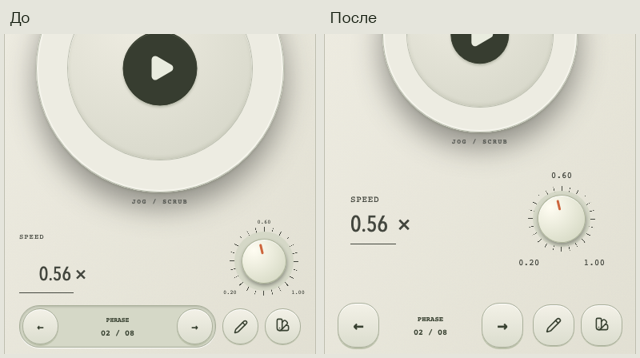

# Mobile touch layout · 20 October 2026

[Orbit](http://127.0.0.1:8780/2026-10-20-touch-layout/live/index.html?skin=ivory) · [Все14](http://127.0.0.1:8780/2026-10-20-touch-layout/review.html)

Скорость больше не примыкает к перелистыванию. Общий мобильный слой применяется ко всем14 выбранным пультам и сохраняет их материалы, механизмы, табло и семантику управления.

- Между интерактивными поверхностями скорости/точного ввода и нижними действиями — как минимум20 CSS px свободной неактивной зоны. У обычного столбца используются24px между секциями плюс внутренние отступы; проверяется фактическое расстояние hit targets, а не только margin.
- Перелистывание —56px высотой и52–56px шириной. Quick Edit/выбор скина —52×52 или шире. Стрелки увеличены до22px, мелкие PREV/NEXT скрыты; доступные имена кнопок сохранены.
- Название и точное значение скорости находятся в одной группе. Число28px, поле48px высотой и не уже52px; знак× не болтается отдельно. Нормальное поле ввода и все native range/relative capture gestures сохранены.
- Подписи шкалы —11px вместо7–8px. Между видимыми числами не меньше8px. Числам запрещён flex-shrink: ранее прямоугольники меток не пересекались, но сами цифры выходили за них и визуально слипались. На коротких боковых/landscape шкалах остаются крайние значения; текущее0.56× всегда крупное.
- На коротком портрете скорость стоит сбоку. Для Arcade/Thumbprint/Correspondent такой вариант включается раньше, чтобы отдельный Play не вытеснял колесо. В landscape их Play находится сбоку от колеса. Минимальный диаметр jog128px сохраняется.
- На особенно коротком landscape убран технический kicker из табло; показание и RUN/HOLD остаются. Нет скролла и пересечений readout/wheel/speed.

## Пройденные проверки

- 92 client unit tests и production build прошли. Протокол, API и данные сеанса не менялись; серверные database suites для этой CSS/markup правки заново не запускались.
- Усиленная геометрия исторического каталога:26 ID ×8 размеров ×3 движка =624 состояния. Все3 cases прошли после адаптации компактного режима. Это совместимость старых ID, отбор коллекции остаётся14.
- Тест mobile touch:14 выбранных ×8 размеров ×3 движка =336 состояний. Проверяет размеры/границы hit targets,20px между скоростью и нижними действиями,11px подписи, минимум128px jog, интервалы между метками.42 реальных эмулированных касания свободной зоны не меняют скорость/фразу;42 последующих касания Next перелистывают, сохраняя скорость. Итоговые результаты и промежуточные неудачные проходы — checks.json.
- Парная матрица всех14 прошла во всех3 движках: precision/keyboard, native/relative gestures, время, Play/Pause, reduced motion, контраст. В rendered-contrast добавлены подписи шкалы с целью4.5:1. Последний прогон зафиксирован отдельно.
- Статическая сборка отдельно проверена в3 движках на6 размерах:252 состояния. Пройдены расстояния между действиями, границы, размер колеса, подписи;0 page errors. Проверяются именно построенные файлы, а не только dev server.
- Свежие снимки всех14 при320×568 и390×660 сохранены и просмотрены. Orbit проверен также в Codex in-app browser. Ранние неудачные CSS-компоновки не выдаются за итог.

Проверенные размеры:320×480,320×568,360×640,390×660,390×844,568×320,844×390,768×1024. Статическая матрица использует6 из них. Проверки — браузерная эмуляция; реальная работа пальцем без взгляда, физические iPhone/iPad/Android, VoiceOver/TalkBack не сертифицированы. Пользователь сам оценивает дизайн, отдельные сессии с респондентами не назначались.

История final-audit и более ранние превью сохранены. Production/staging не менялись, merge/deploy не выполнялись. Review остаётся в существующем draft PR.

## Воспроизведение

`node docs/design/2026-10-20-touch-layout/build-review.mjs` и `node docs/design/2026-10-20-touch-layout/verify-review.mjs` при static server8780. Live checks: `npx playwright test test/e2e/remote-touch.spec.ts test/e2e/remote-viewport.spec.ts test/e2e/time-speed-craft.spec.ts`.
